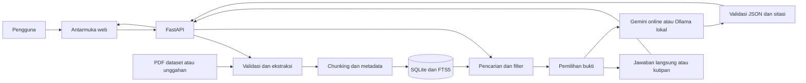
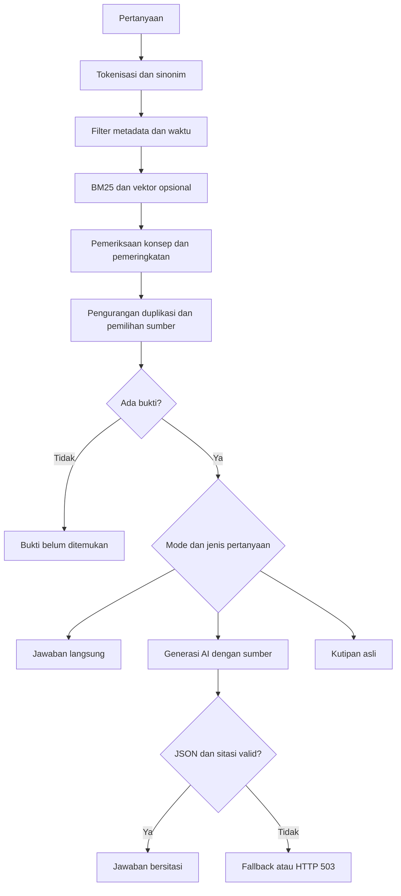
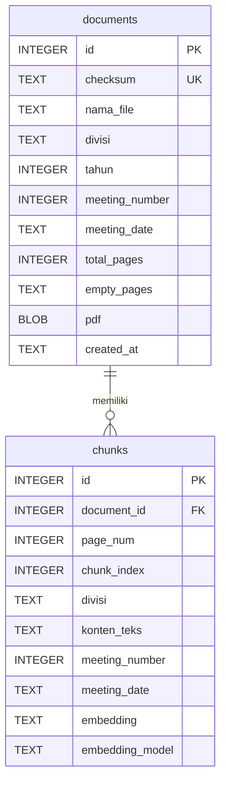

# CampusOrg — Asisten Arsip Soedirman Technophoria 2026

**Sistem pencarian dan tanya jawab notulen organisasi berbasis Retrieval-Augmented Generation (RAG).**

CampusOrg membantu pengguna mencari keputusan, penanggung jawab, kendala, dan perkembangan kegiatan S-TECH 2026 dari PDF notulen. Hasilnya disertai kutipan, tanggal rapat, nomor halaman, dan tautan PDF sumber. Model bahasa dapat menyusun jawaban berdasarkan bukti yang ditemukan melalui Gemini online atau Ollama lokal.

Dokumentasi ini menjelaskan implementasi dan hasil verifikasi pada **19 Oktober 2026**. Isinya dapat digunakan sebagai dasar dokumentasi teknis dan bahan laporan tugas. Versi API yang dideklarasikan aplikasi adalah **2.0.0**.

| Aspek | Implementasi |
| --- | --- |
| Domain | Arsip notulen rapat organisasi mahasiswa, studi kasus S-TECH 2026 |
| Backend | Python, FastAPI, Uvicorn |
| Frontend | HTML, CSS, JavaScript tanpa framework frontend |
| Database aktif | SQLite dengan indeks FTS5 |
| Pencarian utama | BM25, sinonim, filter metadata, dan pemeringkatan berbasis aturan |
| AI yang dikonfigurasi saat ini | Google Gemini `gemini-3.5-flash-lite` |
| Alternatif AI lokal | Ollama dengan `qwen2.5-coder:7b` |
| Pencarian vektor | Opsional; tidak aktif pada konfigurasi utama |
| Dataset evaluasi | 4 PDF, 57 halaman, 131 potongan teks |
| Pengujian otomatis | 72 tes lulus |
| Evaluasi retrieval | 20 dari 20 kasus yang ditetapkan lulus |

## Daftar isi

1. [Latar belakang](#1-latar-belakang)
2. [Tujuan dan ruang lingkup](#2-tujuan-dan-ruang-lingkup)
3. [Fitur aplikasi](#3-fitur-aplikasi)
4. [Dataset dan persiapan dokumen](#4-dataset-dan-persiapan-dokumen)
5. [Teknologi dan dependensi](#5-teknologi-dan-dependensi)
6. [Arsitektur sistem](#6-arsitektur-sistem)
7. [Pengolahan dokumen](#7-pengolahan-dokumen)
8. [Metode pencarian dan RAG](#8-metode-pencarian-dan-rag)
9. [Generasi jawaban dan sitasi](#9-generasi-jawaban-dan-sitasi)
10. [Rancangan database](#10-rancangan-database)
11. [Struktur proyek](#11-struktur-proyek)
12. [Instalasi dan menjalankan aplikasi](#12-instalasi-dan-menjalankan-aplikasi)
13. [Konfigurasi lingkungan](#13-konfigurasi-lingkungan)
14. [Panduan penggunaan](#14-panduan-penggunaan)
15. [Dokumentasi API](#15-dokumentasi-api)
16. [Pengujian dan evaluasi](#16-pengujian-dan-evaluasi)
17. [Pemeliharaan data dan Docker](#17-pemeliharaan-data-dan-docker)
18. [Keamanan, privasi, dan biaya](#18-keamanan-privasi-dan-biaya)
19. [Pemecahan masalah](#19-pemecahan-masalah)
20. [Keterbatasan dan pengembangan](#20-keterbatasan-dan-pengembangan)
21. [Panduan penyusunan laporan tugas](#21-panduan-penyusunan-laporan-tugas)
22. [Referensi](#22-referensi)

## 1. Latar belakang

Notulen menyimpan informasi penting mengenai pembagian tugas, keputusan, vendor, kendala, dan tindak lanjut kegiatan. Ketika arsip bertambah, pencarian manual mengharuskan pengguna membuka beberapa PDF dan menelusuri banyak halaman. Informasi juga dapat berubah antarrapat, sehingga tanggal dan lingkup sumber perlu diperhatikan saat menjawab pertanyaan.

CampusOrg menyediakan pencarian bahasa Indonesia untuk kebutuhan tersebut. Pengguna dapat menanyakan, misalnya, “Apa perkembangan sponsor terbaru?” atau “Siapa penanggung jawab pembicara pada rapat ke-4?”. Sistem mencari bukti dari arsip sebelum menyusun jawaban dan menyediakan sumber agar hasil dapat diperiksa.

Pendekatan yang digunakan adalah **Retrieval-Augmented Generation**: hasil pencarian dokumen menjadi konteks bagi model bahasa. Pada implementasi ini, pencarian utama menggunakan BM25. Embedding dan pencarian semantik merupakan fitur opsional, sehingga RAG tetap dapat berjalan tanpa database vektor.

Proyek tidak melatih atau melakukan fine-tuning model menggunakan notulen. PDF diolah menjadi indeks pencarian, lalu model yang sudah tersedia dipanggil saat diperlukan. Penambahan dokumen dilakukan melalui impor dan pengindeksan, bukan pelatihan ulang AI.

Landasan konsep RAG dapat dirujuk pada [Lewis dkk. (2020)](https://arxiv.org/abs/2005.11401). CampusOrg menerapkan pola pencarian diikuti generasi melalui API; proyek ini tidak mereplikasi proses pelatihan bersama retriever dan generator pada penelitian tersebut.

## 2. Tujuan dan ruang lingkup

### 2.1 Tujuan

1. Mempermudah pencarian informasi notulen tanpa membuka seluruh PDF secara manual.
2. Menghubungkan jawaban dengan kutipan dan halaman sumber.
3. Mendukung penelusuran menurut divisi, tahun, dokumen, dan rapat.
4. Mempertahankan lingkup rapat historis maupun rapat terbaru dalam arsip.
5. Menyediakan hasil yang tetap berguna ketika layanan AI gagal atau kuotanya habis.
6. Menghasilkan aplikasi lokal yang dapat dijalankan, diperiksa, dan diuji ulang.

### 2.2 Sasaran pengguna

Pengguna yang dituju adalah panitia, pengurus organisasi, dan pihak yang memerlukan akses ke arsip kegiatan. Proyek juga dapat menjadi studi kasus pengolahan PDF, pencarian informasi, REST API, dan integrasi model bahasa.

### 2.3 Batas ruang lingkup

Sistem mengolah PDF yang memiliki teks yang dapat diekstraksi. Domain pengujian utamanya adalah empat notulen rapat besar S-TECH 2026. Parser dapat menangani PDF gabungan beberapa rapat jika pola metadata dikenali, tetapi dukungan terhadap semua format dokumen belum dibuktikan.

Aplikasi belum menyediakan OCR, akun pengguna, izin per divisi, audit akses individual, penyuntingan PDF melalui UI, atau endpoint penghapusan dokumen individual. Sistem tidak mencari fakta melalui internet. Pada mode Gemini, model menerima konteks arsip terpilih yang dikirim server.

## 3. Fitur aplikasi

| Fitur | Perilaku |
| --- | --- |
| Impor otomatis | PDF yang cocok dengan pola dataset diproses saat startup jika diaktifkan. |
| Unggah PDF | Pengguna mengunggah PDF dengan kategori dan tahun melalui UI atau API. |
| Pencegahan duplikasi | SHA-256 isi berkas mencegah impor ulang PDF identik, walaupun nama berbeda. |
| Metadata per potongan | Menyimpan dokumen, halaman, divisi, nomor rapat, dan tanggal rapat. |
| Pencarian tanpa AI | `/search` mengembalikan bukti yang relevan. |
| Tanya jawab | `/ask` mengembalikan jawaban, referensi, serta metadata pemrosesan. |
| Filter | Divisi, tahun, dokumen, dan nomor rapat mempersempit sumber. |
| Lingkup waktu | Informasi terbaru mengacu pada tanggal rapat terbaru dalam filter aktif. |
| Perbandingan | Pemilihan sumber mengupayakan keterwakilan beberapa rapat. |
| Jawaban langsung | Pernyataan peran tertentu yang eksplisit dapat dijawab tanpa AI. |
| Sitasi | ID sumber seperti `[S1]` divalidasi terhadap konteks model. |
| Pemeriksaan sumber | Kutipan lengkap dan tautan PDF tersedia. |
| Fallback | Mode `auto` menampilkan kutipan asli jika generasi gagal. |
| Statistik | Jumlah dokumen, halaman, potongan, dan status layanan AI ditampilkan. |
| Tampilan responsif | Antarmuka mendukung layar desktop dan ponsel. |
| Backup | Database dapat dicadangkan secara konsisten, termasuk PDF di dalamnya. |
| Proteksi opsional | Key bersama melindungi endpoint arsip melalui `X-API-Key`. |

## 4. Dataset dan persiapan dokumen

### 4.1 Korpus evaluasi

Hasil impor ulang empat PDF ke database sementara kosong pada 19 Oktober 2026:

| Berkas | Rapat | Tanggal | Halaman | Potongan teks |
| --- | ---: | --- | ---: | ---: |
| `NOTULA RABES STECH 2026 1.pdf` | 1 | 20 Mei 2026 | 16 | 42 |
| `NOTULA RABES STECH 2026 2.pdf` | 2 | 4 Juli 2026 | 12 | 28 |
| `NOTULA RABES STECH 2026 3.pdf` | 3 | 26 Agustus 2026 | 10 | 25 |
| `NOTULA RABES STECH 2026 4.pdf` | 4 | 7 Oktober 2026 | 19 | 36 |
| **Total** | **4 rapat** | | **57** | **131** |

Parser mengenali divisi **Acara, ATP, Humas, Keamanan, Konsumsi, PDD, Sekbend, dan Usdan**. Bagian tanpa heading yang dikenali memakai kategori awal, biasanya **Umum**. Ejaan `Sekben` dinormalisasi menjadi `Sekbend`.

### 4.2 Perbaikan dataset

PDF awal tertentu memuat tambahan rapat lain. PDF 1 diperbaiki dari 37 menjadi 16 halaman dan PDF 2 dari 22 menjadi 12 halaman. PDF 3 dan PDF 4 tidak diubah.

Batas antarrapat pada PDF 1 dan PDF 2 berada di tengah halaman. Perbaikan mempertahankan penutup rapat yang benar dan menghapus bagian rapat berikutnya melalui redaksi PDF. Detail pemeriksaan teks, render, checksum, dan lokasi backup tersedia dalam [PDF_REPAIR_REPORT.md](PDF_REPAIR_REPORT.md).

Periksa rencana perbaikan tanpa menulis berkas:

```powershell
.\venv\Scripts\python.exe repair_datasets.py
```

Opsi `--apply` pada skrip tersebut melakukan perubahan dengan backup terlebih dahulu. Perbaikan tidak perlu diulang untuk penggunaan harian pada dataset yang sudah benar.

### 4.3 Korpus evaluasi berbeda dari database aktif

Saat dokumentasi disusun, database lokal aktif memuat **6 dokumen, 116 halaman, dan 282 potongan teks**. Statistik ini mencerminkan isi database yang telah tersimpan, sedangkan evaluasi retrieval memakai empat PDF pada tabel di atas.

Jumlah pada UI mengikuti database aktif dan dapat berubah setelah unggahan atau impor. Untuk laporan eksperimen yang dapat diulang, gunakan statistik korpus sementara dari `evaluate.py`. Catatan perbaikan PDF menjelaskan kondisi pada saat perbaikan dilakukan, bukan jaminan jumlah dokumen aktif untuk selamanya.

## 5. Teknologi dan dependensi

### 5.1 Komponen utama

| Teknologi | Peran |
| --- | --- |
| Python | Backend dan skrip pemeliharaan. |
| FastAPI | Routing API, validasi request, lifecycle, dan OpenAPI. |
| Uvicorn | Server ASGI untuk FastAPI. |
| Pydantic | Validasi input dan struktur JSON jawaban AI. |
| PyMuPDF | Ekstraksi teks PDF dan perbaikan dataset. |
| SQLite | Penyimpanan PDF, metadata, potongan, dan embedding opsional. |
| SQLite FTS5 | Indeks teks dan fungsi BM25. |
| HTTPX | Komunikasi HTTP asinkron dengan penyedia AI. |
| python-multipart | Unggahan berkas multipart. |
| python-dotenv | Membaca `.env`. |
| HTML/CSS/JavaScript | UI dan komunikasi API melalui `fetch`. |
| Sentence Transformers | Encoder multilingual opsional. |
| Docker Compose | Alternatif menjalankan aplikasi dalam container. |

Dependensi dasar terdapat pada [requirements.txt](requirements.txt); dependensi semantik pada [requirements-semantic.txt](requirements-semantic.txt). Versi paket dibatasi dengan rentang, bukan lockfile versi patch yang sepenuhnya tetap.

### 5.2 Lingkungan yang diverifikasi

Snapshot lingkungan lokal pada 19 Oktober 2026:

| Komponen | Versi terpasang |
| --- | --- |
| Python | 3.14.7 |
| SQLite | 3.50.4 |
| FastAPI | 0.141.1 |
| Uvicorn | 0.53.0 |
| HTTPX | 0.28.1 |
| PyMuPDF | 1.28.2 |
| Pydantic | 2.13.5 |
| python-multipart | 0.0.32 |
| python-dotenv | 1.2.3 |

Dockerfile memakai basis `python:3.12-slim`. Kode dasar memerlukan Python 3.12+ serta SQLite yang mendukung FTS5. Versi di tabel merupakan lingkungan pengujian aktual, bukan pernyataan bahwa seluruh kombinasi versi lain telah diuji.

## 6. Arsitektur sistem

### 6.1 Komponen dan hubungan



UI hanya berkomunikasi dengan server aplikasi. Key penyedia AI tetap berada di server. PDF dan database tersimpan lokal; saat Gemini digunakan, server mengirim pertanyaan serta potongan sumber terpilih ke Google.

### 6.2 Lifecycle dan konkurensi

Saat startup, server menginisialisasi SQLite, mengimpor dataset jika diaktifkan, membuka HTTP client bersama, dan menyiapkan pembatas generasi. Ollama dapat memuat model di latar belakang. Gemini tidak memerlukan pemuatan model lokal.

Ekstraksi, pencarian, dan operasi database tertentu berjalan melalui thread pool agar pekerjaan sinkron tidak menahan event loop. Generasi dibatasi satu semaphore per proses aplikasi. Jika slot sibuk, mode `auto` menampilkan kutipan; mode wajib AI mengembalikan HTTP 503. Pembatas ini tidak berlaku secara global lintas beberapa worker atau server.

## 7. Pengolahan dokumen

### 7.1 Validasi

Sistem memeriksa ukuran berkas, nama, penanda awal `%PDF-`, kemampuan parser membuka PDF, status enkripsi, jumlah halaman, dan teks yang dapat digunakan. Bawaan batas unggahan adalah **25 MB per PDF** dan **300 halaman**. Batas ukuran dihitung sebagai `25 × 1024 × 1024` byte. Nama berkas maksimal 255 karakter dan harus berakhiran `.pdf`.

PDF rusak, terkunci, atau tanpa teks yang dapat diindeks ditolak. Halaman dengan hasil teks kurang dari 20 karakter dicatat dalam `empty_pages` dan dilewati. Pada PDF campuran, halaman lain tetap dapat diproses.

### 7.2 Ekstraksi dan metadata

PyMuPDF mengekstraksi teks per halaman dengan pengurutan teks aktif. Teks dinormalisasi menggunakan Unicode NFKC, dibersihkan dari karakter nol dan zero-width space, lalu dirapikan spasinya. Baris kop surat tertentu yang dikenali dibuang untuk mengurangi pengulangan.

Nomor dan tanggal rapat dikenali dari pola seperti `Rapat ke 04` dan `Tanggal 07 Oktober 2026`. Heading divisi dikenali dari bagian bernomor, misalnya `1. Humas`. Divisi diteruskan ke halaman lanjutan sampai heading baru ditemukan. Jika rapat baru dikenali dalam PDF gabungan, metadata rapat diperbarui untuk isi berikutnya.

### 7.3 Pembagian teks

`chunk_pdf_smart` menggunakan bawaan **1.200 karakter per potongan** dan **180 karakter overlap**. Pemotongan diupayakan pada baris baru atau spasi dalam paruh akhir rentang. Overlap membantu mempertahankan konteks di batas potongan. Ukuran tersebut berdasarkan karakter, bukan token AI.

Potongan mengikuti bagian dan halaman; teks tidak digabung melintasi halaman. Ini memudahkan pelacakan sumber, tetapi konteks yang berlanjut ke halaman berikutnya bisa tetap terpisah.

### 7.4 Deduplication dan transaksi

SHA-256 seluruh byte PDF menjadi identitas isi. Impor biasa tidak menambah dokumen jika checksum sudah ada. Opsi reindex membangun ulang hasil ekstraksi dan embedding untuk berkas dataset yang sama.

PDF, metadata, dan potongan disimpan dalam satu transaksi. Trigger SQLite menjaga sinkronisasi FTS pada insert, update, dan delete. Kegagalan transaksi tidak meninggalkan penyimpanan dokumen yang hanya selesai sebagian.

## 8. Metode pencarian dan RAG

### 8.1 Alur pertanyaan



### 8.2 Pemrosesan pertanyaan

Sistem mengekstraksi token huruf/angka, menghapus stopword, dan membentuk kelompok konsep. Stopword meliputi kata tanya, kata fungsi, dan istilah umum domain. Nomor rapat diproses sebagai filter tersendiri.

Sinonim manual menghubungkan istilah berikut, antara lain:

| Konsep | Contoh perluasan |
| --- | --- |
| Sponsor | `sponsor`, `sponsorship`, `sponsoran` |
| Kendala | `kendala`, `hambatan`, `masalah`, `kesulitan` |
| Kemajuan | `progres`, `progress`, `perkembangan` |
| Penanggung jawab | `jobdesk`, `tugas`, `pj`, `pic`, `mengurus`, `menangani` |
| Pembicara | `pembicara`, `narasumber`, `speaker` |
| Anggaran | `anggaran`, `rab`, `biaya`, `budget`, `dana` |

Tahap ini memakai aturan, bukan model AI khusus pemahaman intent.

### 8.3 Filter dan waktu

Request dapat menentukan `divisi`, `tahun`, dan `document_id`. Nomor rapat dikenali dari teks, termasuk `rapat ke-2` atau `rapat kedua`. Jika field divisi tidak diisi, parser mencoba mengenalinya dari pertanyaan.

Aturan lingkup waktu:

- `terbaru`, `terakhir`, atau `terkini` membatasi ke tanggal rapat terbaru dalam filter aktif.
- Pertanyaan `siapa` tanpa nomor rapat, penanda historis, atau perbandingan secara implisit memakai rapat terbaru.
- Pertanyaan yang menyebut rapat tertentu mempertahankan filter historis tersebut.
- Pertanyaan perbandingan mengupayakan bukti dari beberapa rapat.
- Jika bukti topik tidak ditemukan pada rapat terbaru, sistem tidak beralih diam-diam ke rapat lama.

“Terbaru” berarti terbaru di dalam arsip yang difilter, bukan informasi aktual dari internet. Filter dokumen membatasi PDF; satu PDF gabungan bisa memuat beberapa rapat.

### 8.4 BM25 dan pemeringkatan

FTS5 menjalankan `bm25(chunks_fts, 1.0, 0.35)` dengan bobot teks lebih besar daripada kolom divisi. SQLite mengurutkan nilai BM25 dari yang lebih kecil. Implementasi selanjutnya memakai peringkat kandidat sebagai kontribusi skor, bukan menggunakan skor BM25 sebagai probabilitas. Penjelasan fungsi tersedia pada [dokumentasi BM25 SQLite](https://www.sqlite.org/fts5.html#the_bm25_function).

Maksimal 120 kandidat BM25 diambil. Sistem kemudian memeriksa ketercakupan konsep dan menerapkan pengali berbasis aturan. Misalnya, heading `Progress Sponsor` mendapat penguatan pada pertanyaan kemajuan sponsor. Kalimat keputusan mengenai juri lebih diutamakan daripada daftar panitia yang bertugas mengurus juri.

Dasar penghitungan skor dapat diringkas sebagai:

```text
RRF(d) = jumlah pada setiap daftar hasil: 1 / (60 + peringkat(d))
coverage(d) = jumlah kelompok konsep yang cocok / jumlah kelompok konsep pertanyaan
skor_awal(d) = RRF(d) × (0,4 + 0,6 × coverage(d))
```

Mode BM25 menyumbangkan satu daftar peringkat. Mode hybrid menambahkan kontribusi peringkat vektor. Pengali domain diterapkan setelah skor awal. Nilai akhir adalah skor pengurutan internal, bukan tingkat keyakinan bahwa jawaban benar.

Referensi metode penggabungan peringkat adalah [Cormack, Clarke, dan Büttcher (2009)](https://plg.uwaterloo.ca/~gvcormac/cormacksigir09-rrf.pdf). Pengali coverage dan aturan khusus S-TECH merupakan tambahan implementasi proyek, bukan klaim hasil dari penelitian RRF tersebut.

Sistem mengurangi potongan identik atau sangat mirip dalam rapat/divisi yang sama serta membatasi dua hasil per halaman. `top_k` menentukan jumlah hasil, dengan bawaan 8 dan rentang 1–12. Untuk perbandingan, sumber dari rapat berbeda dipilih terlebih dahulu jika kandidat tersedia.

### 8.5 Penolakan hasil di luar topik

Pemeriksaan konsep membantu mencegah kata umum seperti `harga` menghasilkan potongan yang tidak membahas subjek pertanyaan, misalnya bitcoin. Jika bukti yang memenuhi aturan tidak ada, sistem mengembalikan respons tanpa bukti dan tidak memanggil model.

Aturan ini tetap heuristik. Salah ketik, istilah baru, dan parafrasa dapat membuat bukti terlewat. “Bukti belum ditemukan” menyatakan hasil pencarian sistem, bukan pembuktian bahwa fakta tersebut sama sekali tidak ada di semua arsip.

### 8.6 Pencarian semantik opsional

`SemanticEncoder` memuat model `sentence-transformers/paraphrase-multilingual-MiniLM-L12-v2` secara lazy. Embedding dinormalisasi, disimpan sebagai JSON pada `chunks`, dan diberi nama model pembentuknya.

Saat pencarian, cosine similarity dihitung di Python terhadap baris yang memenuhi filter dan nama model. Kandidat dengan similarity minimal 0,58 dapat masuk daftar vektor; minimal 0,65 dapat melewati sebagian pemeriksaan kecocokan kata kunci. Peringkat BM25 dan vektor digabung melalui reciprocal rank fusion.

Jalur ini belum memakai indeks approximate nearest neighbor. Perhitungan vektor langsung perlu diuji skalanya untuk korpus besar. Tes semantik saat ini memakai encoder simulasi; evaluasi utama belum memuat eksperimen dengan model multilingual nyata.

## 9. Generasi jawaban dan sitasi

### 9.1 Penyedia dan mode

| `ANSWER_MODE` | Perilaku |
| --- | --- |
| `auto` | Coba jawaban peran langsung; jika perlu panggil `LLM_PROVIDER`; saat gagal tampilkan kutipan. |
| `extractive` | Kutipan sumber tanpa generasi AI. |
| `gemini` | Wajib menggunakan Gemini; kegagalan generasi menjadi HTTP 503. |
| `ollama` | Wajib menggunakan Ollama; kegagalan generasi menjadi HTTP 503. |

Mode `gemini` dan `ollama` mengesampingkan `LLM_PROVIDER`. Jika tidak ada bukti, respons `no_evidence` tetap dapat dikembalikan tanpa panggilan AI, termasuk pada mode wajib model.

Konfigurasi aktif memakai `gemini-3.5-flash-lite`. Model ini menyediakan Free tier menurut [halaman harga Google](https://ai.google.dev/gemini-api/docs/pricing). Akses dan kuota mengikuti proyek pengguna; aplikasi tidak dapat memastikan paket billing dari API key.

### 9.2 Konteks dan prompt

Prompt memuat instruksi sistem, pertanyaan, sumber terpilih, dan riwayat singkat. Instruksi meminta bahasa Indonesia, maksimal 80 kata, hanya fakta dari sumber, pembedaan keputusan/rencana, serta pelestarian ketidakpastian. Batas 80 kata adalah instruksi prompt, bukan validasi penghitung kata terpisah.

| Penyedia | Sumber terfokus | Sumber perbandingan | Batas karakter per sumber |
| --- | ---: | ---: | ---: |
| Gemini | Maksimal 4 | Maksimal 8 | 1.600 |
| Ollama, konfigurasi bawaan | Maksimal 2 | Maksimal 4 | 650 |

Jumlah aktual dibatasi hasil retrieval dan anggaran konteks. Referensi API tetap dapat memuat lebih banyak sumber daripada yang dikirim ke model. Riwayat generasi memakai dua pesan terakhir, masing-masing maksimal 600 karakter, sebagai data yang tidak terverifikasi.

Pertanyaan lanjutan sederhana dapat menambahkan topik dari pesan pengguna sebelumnya ke pencarian. Dukungan percakapan masih berbasis aturan dan tidak menyediakan sesi persisten pada server.

### 9.3 Keluaran terstruktur

Model diminta menghasilkan JSON berikut:

```json
{
  "paragraf": [
    {"teks": "Penjelasan berdasarkan sumber.", "sumber": ["S1"]}
  ]
}
```

Pydantic memvalidasi strukturnya. Server memeriksa bahwa ID yang disebut termasuk konteks, sitasi inline tidak keluar dari deklarasi paragraf, dan teks tidak kosong. Jika sitasi belum ditulis pada teks, server menambahkannya dari daftar `sumber`.

Pemeriksaan tersebut memastikan bentuk keluaran dan keberadaan rujukan. Sistem belum memvalidasi secara otomatis bahwa setiap kalimat sepenuhnya didukung bukti. Sitasi yang sah tidak sama dengan jaminan kebenaran semua klaim.

### 9.4 Jawaban langsung dari arsip

Pada mode `auto`, pertanyaan mengenai juri, pembicara, narasumber, moderator, atau MC dapat dijawab langsung jika sumber memuat pernyataan peran yang eksplisit dan sesuai topik. Metadata memakai `answer_mode=source_match` dan `llm_skipped=true`.

Pernyataan bahwa seorang juri sudah pasti sementara orang lain belum pasti hadir harus mempertahankan ketidakpastian tersebut. Daftar panitia yang mengurus juri juga dibedakan dari orang yang menjadi juri. Jalur ini menghemat panggilan model, tetapi bukan penjawab otomatis untuk seluruh bentuk pertanyaan faktual.

### 9.5 Kegagalan dan fallback

| `fallback_reason` | Makna |
| --- | --- |
| `api_key_missing` | Key Gemini belum diisi. |
| `api_key_invalid` | Key atau izin Gemini ditolak. |
| `rate_limited` | Penyedia mengembalikan HTTP 429. |
| `invalid_request` | Konfigurasi/format request Gemini ditolak. |
| `model_missing` | Model belum terpasang atau tidak tersedia. |
| `llm_timeout` | Batas waktu terlampaui. |
| `llm_unavailable` | Layanan atau koneksi bermasalah. |
| `invalid_response` | Respons tidak lengkap atau bentuknya tidak valid. |
| `invalid_citations` | ID sumber jawaban tidak sah. |
| `llm_busy` | Slot generasi sedang digunakan. |
| `llm_warming` | Model lokal sedang dimuat. |

Pada mode `auto`, fallback menyajikan kutipan asli dengan pesan yang menyatakan bahwa kutipan belum disintesis AI. Aplikasi tidak melakukan retry generasi atau perpindahan otomatis ke paket berbayar.

## 10. Rancangan database

Database utama adalah `data/campusorg.sqlite3`, kecuali `DATA_DIR` diubah. Struktur utamanya terdiri dari `documents`, `chunks`, dan tabel virtual `chunks_fts`.



| Struktur | Isi dan fungsi |
| --- | --- |
| `documents` | PDF sebagai BLOB, checksum unik, nama, kategori, tahun, metadata rapat awal, jumlah halaman, halaman kosong JSON, dan waktu pembuatan. |
| `chunks` | Potongan teks, halaman, indeks potongan, divisi, metadata rapat, embedding opsional, serta nama model embedding. |
| `chunks_fts` | Indeks FTS5 untuk `konten_teks` dan `divisi`, memakai external content dari `chunks`. |

Satu dokumen memiliki banyak potongan. Kombinasi `document_id` dan `chunk_index` unik. Foreign key memakai `ON DELETE CASCADE`; trigger menjaga FTS mengikuti perubahan potongan.

Koneksi mengaktifkan foreign keys, busy timeout 30 detik, serta write-ahead logging (WAL). Penyimpanan menggunakan `BEGIN IMMEDIATE` sebelum pemeriksaan duplikasi. Backup melalui API backup SQLite mencakup PDF yang berada dalam database.

SQLite menyederhanakan instalasi lokal. PostgreSQL/pgvector masih ada pada profil prototipe lama, tetapi tidak digunakan aplikasi aktif. Tidak tersedia migrasi otomatis arsip PostgreSQL ke SQLite.

## 11. Struktur proyek

```text
campusorg-rag-copilot/
├── main.py                    # Aplikasi FastAPI dan endpoint
├── config.py                  # Konfigurasi dan validasi
├── models.py                  # Skema pertanyaan dan riwayat
├── database.py                # Repository SQLite
├── ingestion.py               # Validasi PDF, ekstraksi, metadata, chunking
├── retrieval.py               # Pencarian, filter, ranking, vektor opsional
├── answering.py               # Prompt, model AI, fallback, dan sitasi
├── ingest.py                  # CLI impor/reindex
├── evaluate.py                # Evaluasi pada database sementara
├── eval_cases.json            # Pertanyaan dan kriteria evaluasi
├── backup.py                  # CLI backup
├── clear_db.py                # Reset eksplisit dengan backup
├── init_db.py                 # Inisialisasi skema
├── upgrade_db.py              # Upgrade skema idempoten
├── repair_datasets.py         # Pemeriksaan/perbaikan PDF dataset
├── make_dummy.py              # Pembuat contoh PDF prototipe lama
├── start.ps1                  # Helper startup Windows
├── requirements.txt
├── requirements-semantic.txt
├── .env.example
├── Dockerfile
├── docker-compose.yml
├── static/
│   ├── index.html
│   ├── style.css
│   ├── app.js
│   └── favicon.svg
├── tests/
│   ├── test_core.py            # 63 tes inti
│   ├── test_gemini.py          # 9 tes Gemini dengan HTTP simulasi
│   └── browser-smoke.mjs
├── data/                      # Database, backup, dan log lokal
├── scratch/                   # Artefak sementara dan screenshot
├── NOTULA RABES STECH 2026 *.pdf
├── EVALUATION.md
├── PERFORMANCE.md
└── PDF_REPAIR_REPORT.md
```

`venv` dan `.env` disiapkan lokal. `.gitignore` mengabaikan environment, database, log, dan artefak sementara. `make_dummy.py` tidak diperlukan dalam instalasi atau alur arsip S-TECH.

## 12. Instalasi dan menjalankan aplikasi

### 12.1 Persyaratan

- Python 3.12+ dengan SQLite FTS5.
- Akses instalasi paket pada pemasangan awal.
- Browser modern.
- Internet dan key Gemini untuk AI online.
- Ollama/model lokal hanya jika memilih penyedia lokal.
- Node.js 22+ dan Chromium hanya untuk browser smoke test.

GPU tidak diperlukan untuk BM25 atau Gemini. Perangkat memengaruhi kecepatan dan kemampuan pemuatan Ollama.

### 12.2 Menjalankan proyek yang sudah siap

Dari root proyek:

```powershell
.\venv\Scripts\python.exe -m uvicorn main:app --host 127.0.0.1 --port 8000
```

Alternatif Windows:

```powershell
powershell -ExecutionPolicy Bypass -File .\start.ps1
```

Buka **http://127.0.0.1:8000**. Dokumentasi API tersedia pada **http://127.0.0.1:8000/docs**. Jika server sudah berjalan, gunakan instance tersebut atau hentikan proses lama sebelum memakai port yang sama. Server pada terminal dapat dihentikan dengan `Ctrl+C`.

### 12.3 Instalasi Windows baru

```powershell
python -m venv venv
.\venv\Scripts\python.exe -m pip install -r requirements.txt
if (-not (Test-Path -LiteralPath .env)) {
    Copy-Item -LiteralPath .env.example -Destination .env
}
```

Isi `.env`, lalu jalankan server. Jangan menimpa `.env` yang sudah berisi konfigurasi. Pemanggilan interpreter secara langsung membuat aktivasi environment tidak wajib.

### 12.4 Linux/macOS

```bash
python3 -m venv venv
./venv/bin/python -m pip install -r requirements.txt
if [ ! -f .env ]; then
  cp .env.example .env
fi
./venv/bin/python -m uvicorn main:app --host 127.0.0.1 --port 8000
```

Perintah mengikuti struktur Python lintas platform; verifikasi utama proyek dilakukan pada Windows. `start.ps1` ditujukan untuk Windows.

### 12.5 Gemini online

1. Buat key melalui [Google AI Studio](https://aistudio.google.com/apikey). Gunakan proyek Free tier jika ingin memakai kuota gratis.
2. Isi `.env`:

```dotenv
ANSWER_MODE=auto
LLM_PROVIDER=gemini
GEMINI_API_KEY=isi_key_pribadi_di_sini
GEMINI_MODEL=gemini-3.5-flash-lite
GEMINI_TIMEOUT_SECONDS=40
GEMINI_MAX_TOKENS=2048
```

3. Restart server setelah mengubah konfigurasi.
4. Periksa indikator layanan dan coba pertanyaan yang memerlukan penjelasan.

Key Gemini berbeda dari key pelindung arsip. Jangan memasukkannya ke kolom “Koneksi terlindungi” pada UI.

### 12.6 Kutipan tanpa AI

```dotenv
ANSWER_MODE=extractive
SEMANTIC_SEARCH=false
```

Sesudah dependensi dan dataset tersedia, pencarian serta UI utama dapat digunakan tanpa layanan AI atau internet. `/docs` bawaan FastAPI memakai aset CDN sehingga tampilannya dapat memerlukan internet.

### 12.7 Ollama lokal

```dotenv
ANSWER_MODE=auto
LLM_PROVIDER=ollama
OLLAMA_BASE_URL=http://127.0.0.1:11434
OLLAMA_MODEL=qwen2.5-coder:7b
```

Jika model belum tersedia:

```powershell
ollama pull qwen2.5-coder:7b
ollama serve
```

Jalankan server aplikasi pada terminal lain. Pada Windows, helper berikut dapat menyalakan Ollama di latar belakang jika belum berjalan dan penyedia aktif adalah Ollama:

```powershell
powershell -ExecutionPolicy Bypass -File .\start.ps1 -WithAI
```

Helper memakai library `vulkan`, konteks 4.096 token, keep-alive 30 menit, dan margin VRAM 512 MiB untuk proses baru. Parameter `-OllamaLibrary`, `-GpuMarginMB`, dan `-Port` dapat disesuaikan. Opsi tidak mengubah proses Ollama yang sudah berjalan. Helper hanya memeriksa alamat default `127.0.0.1:11434`; layanan dengan alamat kustom perlu dijalankan sendiri.

## 13. Konfigurasi lingkungan

`.env` dibaca dari root proyek saat konfigurasi diimpor. Environment variable proses lebih diprioritaskan. Perubahan konfigurasi memerlukan restart; tidak tersedia reload `.env` otomatis.

### 13.1 Umum dan penyimpanan

| Variabel | Bawaan kode | Fungsi |
| --- | --- | --- |
| `DATA_DIR` | `data` | Direktori database/backup; path relatif dihitung dari root proyek. |
| `DATASET_DIR` | `.` | Direktori PDF untuk impor. |
| `DATASET_GLOB` | `NOTULA RABES STECH 2026 *.pdf` | Pola berkas dataset. |
| `AUTO_IMPORT` | `true` | Impor saat startup. |
| `MAX_UPLOAD_MB` | `25` | Batas ukuran satu PDF. |
| `MAX_PDF_PAGES` | `300` | Batas halaman. |
| `ANSWER_MODE` | `auto` | Mode jawaban. |
| `LLM_PROVIDER` | `ollama` | Penyedia pada mode `auto`. |
| `API_KEY` | kosong | Key pelindung arsip jika diisi. |

Tanpa `.env`/environment, kode memilih Ollama. `.env.example` dan Compose menyiapkan Gemini; konfigurasi aktif komputer ini juga memakai Gemini. Perbedaan bawaan kode dan contoh konfigurasi perlu diperhatikan saat instalasi.

### 13.2 Gemini

| Variabel | Bawaan | Keterangan |
| --- | --- | --- |
| `GEMINI_API_KEY` | kosong | Secret akses Google, hanya pada server. |
| `GEMINI_MODEL` | `gemini-3.5-flash-lite` | Model yang dipanggil. |
| `GEMINI_TIMEOUT_SECONDS` | `40` | Batas total generasi. |
| `GEMINI_MAX_TOKENS` | `2048` | Batas keluaran request; rentang 256–8.192. |

HTTPX memanggil endpoint tetap `https://generativelanguage.googleapis.com/v1beta/interactions` memakai header `x-goog-api-key`, keluaran JSON berskema, dan `thinking_level=low`. Tidak diperlukan SDK Gemini tambahan. HTTP client memakai `trust_env=False`, sehingga proxy dari environment tidak otomatis digunakan.

### 13.3 Ollama

| Variabel | Bawaan | Keterangan |
| --- | --- | --- |
| `OLLAMA_BASE_URL` | `http://127.0.0.1:11434` | Alamat layanan. |
| `OLLAMA_MODEL` | `qwen2.5-coder:7b` | Model yang sudah dipasang. |
| `OLLAMA_TIMEOUT_SECONDS` | `25` | Batas total generasi. |
| `OLLAMA_CONTEXT_TOKENS` | `4096` | Rentang 2.048–32.768. |
| `OLLAMA_MAX_TOKENS` | `256` | Rentang 64–2.048. |
| `OLLAMA_MAX_SOURCES` | `4` | Maksimal sumber perbandingan, rentang 1–8. |
| `OLLAMA_SOURCE_CHARS` | `650` | Karakter per sumber, rentang 300–1.600. |
| `OLLAMA_KEEP_ALIVE` | `30m` | Durasi model bertahan di memori. |
| `OLLAMA_PRELOAD` | `true` | Pemuatan awal di latar belakang. |

Opsi preload dan generasi memakai konteks serta batch yang sama agar tidak memicu pemuatan ulang akibat perbedaan opsi. `num_batch` ditetapkan 128 pada kode.

### 13.4 Semantik

| Variabel | Bawaan | Keterangan |
| --- | --- | --- |
| `SEMANTIC_SEARCH` | `false` | Aktifkan encoder dan pencarian vektor. |
| `EMBEDDING_MODEL` | `sentence-transformers/paraphrase-multilingual-MiniLM-L12-v2` | Nama model embedding. |
| `EMBEDDING_LOCAL_ONLY` | `true` | Model hanya dibaca dari cache lokal. |

Untuk mencoba:

```powershell
.\venv\Scripts\python.exe -m pip install -r requirements-semantic.txt
```

Atur `SEMANTIC_SEARCH=true`. Jika model belum tersedia, `EMBEDDING_LOCAL_ONLY=false` mengizinkan unduhan. Lalu:

```powershell
.\venv\Scripts\python.exe ingest.py --reindex
```

Setelah model tersedia, pengaturan local-only dapat diaktifkan kembali. Perubahan model memerlukan reindex. Kegagalan embedding tidak membatalkan penyimpanan PDF untuk BM25 dan dilaporkan sebagai peringatan. CLI reindex memproses berkas sesuai pola dataset, bukan otomatis semua PDF tambahan yang pernah diunggah.

## 14. Panduan penggunaan

### 14.1 Tanya jawab dan pemeriksaan sumber

1. Buka halaman utama dan tunggu statistik arsip muncul.
2. Pilih divisi atau dokumen jika ingin membatasi sumber.
3. Masukkan pertanyaan yang menyebut topik dengan jelas.
4. Kirim pertanyaan dan baca label mode jawaban.
5. Periksa kutipan, tanggal, dan tautan PDF sebelum menggunakan hasil.

| Pertanyaan contoh | Skenario |
| --- | --- |
| `Siapa penanggung jawab pembicara pada rapat ke-4?` | Pernyataan peran dan jawaban langsung jika eksplisit. |
| `Apa vendor cocard dan lanyard pada rapat ke-2?` | Fakta dan filter historis. |
| `Apa progress Sekbend pada rapat ke-4?` | Divisi dan rapat tertentu. |
| `Apa perkembangan sponsor terbaru?` | Informasi pada tanggal rapat terbaru. |
| `Bandingkan perkembangan sponsorship pada semua rapat.` | Bukti lintas rapat dan rangkuman model. |
| `Berapa harga bitcoin hari ini?` | Penolakan karena bukti tidak ditemukan. |

UI membedakan jawaban Gemini/Ollama, jawaban langsung dari arsip, kutipan, dan tanpa bukti. Catat label itu pada laporan agar `source_match` dan `extractive` tidak dianggap hasil generasi AI.

### 14.2 Unggah dokumen

Gunakan **Tambahkan PDF**, pilih berkas, isi kategori serta tahun, lalu impor. Sistem menampilkan status tiap berkas, termasuk duplikat atau peringatan jika ada. Kategori awal dipakai saat heading divisi tidak dikenali. Format PDF berbeda dapat memerlukan penyesuaian parser.

### 14.3 Riwayat dan key UI

Riwayat chat berada dalam memori JavaScript halaman. Reset membersihkannya; reload halaman memulainya kembali. Key pelindung arsip disimpan dalam `sessionStorage` tab jika diisi. Mekanisme ini bukan penyimpanan key Gemini atau sistem akun pengguna.

## 15. Dokumentasi API

### 15.1 Endpoint

| Metode | Endpoint | Fungsi | Proteksi `API_KEY` |
| --- | --- | --- | --- |
| `GET` | `/` | Halaman HTML. | Tidak |
| `GET` | `/health` | Pemeriksaan database tanpa AI. | Tidak |
| `GET` | `/status` | Statistik, status model, hasil impor startup. | Jika diaktifkan |
| `GET` | `/documents` | Metadata PDF dan daftar rapat yang dikenali. | Jika diaktifkan |
| `GET` | `/documents/{id}/pdf` | PDF yang tersimpan untuk dokumen. | Jika diaktifkan |
| `POST` | `/upload` | Impor PDF multipart. | Jika diaktifkan |
| `POST` | `/search` | Retrieval tanpa generasi. | Jika diaktifkan |
| `POST` | `/ask` | Tanya jawab beserta sumber. | Jika diaktifkan |
| `GET` | `/docs`, `/redoc`, `/openapi.json` | Dokumentasi/skema API. | Tidak |

UI dan aset statis tetap dapat dibuka saat proteksi aktif; akses data arsip diperiksa pada endpoint terkait. Tidak tersedia endpoint penghapusan dokumen.

### 15.2 Body pertanyaan

`/ask` dan `/search` memakai skema yang sama:

```json
{
  "pertanyaan": "Apa progress Sekbend pada rapat ke-4?",
  "divisi": "Sekbend",
  "tahun": 2026,
  "top_k": 8,
  "history": []
}
```

| Field | Wajib | Validasi |
| --- | --- | --- |
| `pertanyaan` | Ya | 3–2.000 karakter; spasi tepi dibersihkan. |
| `divisi` | Tidak | Maksimal 100 karakter. |
| `tahun` | Tidak | 2000–2100. |
| `document_id` | Tidak | Integer minimal 1. |
| `top_k` | Tidak | 1–12, bawaan 8. |
| `history` | Tidak | Maksimal 20 pesan; `null` menjadi daftar kosong. |

Riwayat hanya mengizinkan `role=user` atau `assistant` dengan `content` 1–4.000 karakter. Field tambahan pada body pertanyaan ditolak.

Contoh PowerShell:

```powershell
$ragBody = @{
    pertanyaan = 'Apa perkembangan sponsor terbaru?'
    top_k = 8
    history = @()
} | ConvertTo-Json

Invoke-RestMethod `
    -Uri 'http://127.0.0.1:8000/ask' `
    -Method Post `
    -ContentType 'application/json; charset=utf-8' `
    -Body ([System.Text.Encoding]::UTF8.GetBytes($ragBody))
```

Jika proteksi aktif, tambahkan `-Headers` dengan `X-API-Key` dari konfigurasi lokal pengguna. Jangan menaruh key pada URL atau menyalinnya ke laporan.

### 15.3 Struktur respons `/ask`

Contoh berikut bersifat ilustratif; ID dokumen, isi, dan durasi bergantung pada request serta database:

```json
{
  "status": "success",
  "message": "Pencarian arsip selesai.",
  "data": {
    "query_asli": "Apa perkembangan sponsor terbaru?",
    "jawaban_ai": "Ringkasan berdasarkan notulen. [S1]",
    "referensi": [
      {
        "id": "S1",
        "document_id": 4,
        "file": "NOTULA RABES STECH 2026 4.pdf",
        "halaman": 6,
        "divisi": "Usdan",
        "tahun": 2026,
        "tanggal_rapat": "2026-10-07",
        "rapat_ke": 4,
        "kutipan": "Potongan teks asli dari PDF.",
        "url": "/documents/4/pdf#page=6"
      }
    ],
    "metadata": {
      "retrieval": "bm25",
      "temporal_scope": "latest_explicit",
      "as_of": "2026-10-07",
      "answer_mode": "gemini",
      "provider": "gemini",
      "model_llm": "gemini-3.5-flash-lite",
      "warning": null,
      "fallback_reason": null,
      "retrieval_ms": 10,
      "llm_duration_ms": 5000,
      "duration_ms": 5010,
      "total_referensi_ditemukan": 1
    }
  }
}
```

`referensi` bisa memuat lebih banyak hasil daripada konteks generasi. `context_source_count` dan `context_chars`, jika tersedia, menjelaskan sumber yang benar-benar dikirim ke model. Field token bergantung pada laporan penyedia. Metadata tidak identik untuk setiap mode; misalnya `provider` atau durasi model tidak selalu ada pada respons tanpa bukti.

`/search` mengembalikan `data.referensi` dan `data.metadata` tanpa `jawaban_ai`. `/upload` mengembalikan metadata dokumen serta indikator seperti `duplicate` dan `total_chunks_tersimpan`.

### 15.4 Unggah PDF

```powershell
curl.exe -X POST 'http://127.0.0.1:8000/upload' `
    -F 'file=@NOTULA RABES STECH 2026 4.pdf' `
    -F 'divisi=Umum' `
    -F 'tahun=2026'
```

Field multipart adalah `file`, `divisi` dengan bawaan `Umum`, dan `tahun` dengan bawaan 2026.

### 15.5 Status dan kode HTTP

`/status` menyajikan statistik, divisi, mode, serta objek `ai` dan `ollama`. Pada Gemini, `configured=true` berarti key terisi. `model_ready=true` berarti akses metadata model berhasil, bukan jaminan kuota generasi tersedia.

| Kode | Contoh kondisi |
| --- | --- |
| `200` | Berhasil, termasuk fallback atau tanpa bukti pada alur yang diizinkan. |
| `400` | Header ukuran unggahan tidak valid. |
| `401` | Key pelindung arsip hilang/salah. |
| `404` | ID dokumen PDF tidak ditemukan. |
| `413` | Ukuran unggahan berlebih. |
| `422` | Input tidak valid atau PDF tidak dapat diproses. |
| `503` | Database bermasalah atau generasi wajib gagal. |

HTTP 429 Google dipetakan ke `fallback_reason=rate_limited` pada mode `auto`, bukan diteruskan sebagai HTTP 429 aplikasi. Pesan error API aplikasi biasanya berada pada field `detail`.

## 16. Pengujian dan evaluasi

### 16.1 Tes otomatis

```powershell
.\venv\Scripts\python.exe -m unittest discover -s tests -v
```

Verifikasi ulang pada 19 Oktober 2026 menghasilkan **72 tes lulus**: 63 tes inti dan 9 tes Gemini. Database sementara digunakan agar pengujian tidak menghapus isi arsip pengguna.

| Kelompok | Cakupan |
| --- | --- |
| Penyimpanan | Deduplication, transaksi, impor bersamaan, reindex, backup, dan PDF asli. |
| PDF | Berkas rusak/tanpa teks, halaman kosong, chunking, overlap, dan rapat gabungan. |
| API | Validasi, batas unggahan, proteksi key, filter, dan akses PDF. |
| Jawaban | Sitasi valid/tidak valid, fallback, timeout, jawaban langsung, dan pemisahan peran. |
| Dataset nyata | Halaman, rapat, perbandingan, tanggal terbaru, divisi, dan topik di luar domain. |
| Semantik | Penggabungan hasil serta filter dengan encoder simulasi. |
| Perbaikan PDF | Pelestarian penutup rapat dan pemeriksaan batas rapat. |
| Gemini | Request, key hilang, error izin/kuota, timeout, sitasi, serta status dengan HTTP simulasi. |

Log `Embedding gagal` dapat muncul pada tes yang sengaja mensimulasikan kegagalan. Hasil akhir `OK` menentukan keberhasilan rangkaian. Lingkungan uji juga menampilkan peringatan deprecation HTTPX/TestClient yang belum menyebabkan tes gagal.

### 16.2 Evaluasi retrieval

```powershell
.\venv\Scripts\python.exe evaluate.py --output EVALUATION.md
```

Skrip mengimpor empat dataset ke database sementara. Kasus pada [eval_cases.json](eval_cases.json) memeriksa keberadaan bukti yang diharapkan, cakupan rapat, filter divisi/rapat, dan tidak munculnya bukti untuk pertanyaan di luar domain.

Hasil: **20/20 kasus lulus**, menggunakan BM25 dan `top_k=8`. Rincian per pertanyaan tersedia pada [EVALUATION.md](EVALUATION.md).

Angka ini menyatakan seluruh kasus yang ditetapkan memenuhi kriteria evaluator. Angka tersebut tidak boleh disebut “akurasi AI 100%”. Evaluator belum mengukur kebenaran setiap klaim generatif, penilaian relevansi oleh manusia, precision/recall retrieval formal, atau generalisasi ke semua pertanyaan.

### 16.3 Antarmuka dan browser

```powershell
node --check static/app.js
node tests/browser-smoke.mjs
```

Tes browser memerlukan Node.js 22+ dan Chromium lokal. Jika executable tidak ditemukan pada cache Playwright Windows:

```powershell
$env:BROWSER_EXECUTABLE = 'C:/path/to/chrome.exe'
node tests/browser-smoke.mjs
```

Pemeriksaan meliputi statistik, jumlah dokumen, pertanyaan, kutipan, tautan PDF, tanpa bukti, overflow layar ponsel, serta error browser. Screenshot tersimpan di `scratch/browser/desktop.png`, `answer.png`, dan `mobile.png`.

Browser smoke test telah lulus pada sesi pengembangan. Pertanyaan utamanya dapat menggunakan `source_match`, sehingga kelulusan browser saja belum membuktikan pemanggilan Gemini berhasil.

### 16.4 Uji langsung Gemini

Pada 19 Oktober 2026, uji end-to-end `/ask` memakai pertanyaan:

> Bandingkan perkembangan sponsorship pada semua rapat.

| Pengukuran | Hasil |
| --- | --- |
| HTTP aplikasi | 200 |
| Mode aktual | `gemini` |
| Model | `gemini-3.5-flash-lite` |
| Fallback | Tidak ada |
| Durasi retrieval | 9 ms |
| Durasi generasi | 5.253 ms |
| Durasi server total | 5.262 ms, sekitar 5,3 detik |
| Referensi retrieval | 8 |
| Sumber konteks generasi | 8 |
| Karakter konteks sumber | 7.058 |
| Token input/output yang dilaporkan | 2.467 / 146 |

Jawaban memuat rangkuman perkembangan serta sitasi `[S1]`, `[S2]`, dan `[S3]`. Uji ini memakai database aktif 6 dokumen, sehingga terpisah dari evaluasi empat PDF. Delapan sumber konteks tidak otomatis berarti setiap rapat dibahas lengkap dalam jawaban.

Hasil tersebut adalah satu pengamatan, bukan rata-rata latensi atau jaminan kinerja. Uji pada tabel benar-benar memanggil Google, sedangkan tes otomatis Gemini menggunakan respons HTTP simulasi.

Pengujian lokal sebelumnya tersimpan pada [PERFORMANCE.md](PERFORMANCE.md). Dokumen itu mencatat Ollama dan 63 tes inti sebelum integrasi Gemini; bagian README ini memuat jumlah tes serta model online terkini.

## 17. Pemeliharaan data dan Docker

### 17.1 Impor, reindex, dan skema

```powershell
# Impor berkas sesuai DATASET_GLOB.
.\venv\Scripts\python.exe ingest.py

# Bangun ulang hasil ekstraksi dan embedding dataset yang sama.
.\venv\Scripts\python.exe ingest.py --reindex

# Inisialisasi/upgrade skema tanpa menghapus dokumen.
.\venv\Scripts\python.exe init_db.py
.\venv\Scripts\python.exe upgrade_db.py
```

Impor identik tidak menggandakan isi. Reindex berbeda dari pelatihan model. Setelah perubahan parser atau encoder, periksa ulang hasil evaluasi dan statistik.

### 17.2 Backup dan pemulihan

```powershell
.\venv\Scripts\python.exe backup.py
```

Backup disimpan dalam `data/backups/` memakai timestamp UTC, kecuali tujuan diberikan melalui `--output`. Skrip menolak menimpa tujuan yang sudah ada. PDF, metadata, potongan, dan indeks ikut dicadangkan karena berada di SQLite.

Pemulihan dilakukan dengan langkah berikut:

1. Hentikan server dan proses impor terkait.
2. Pertahankan salinan direktori data saat ini.
3. Siapkan direktori data baru yang kosong.
4. Salin backup sebagai `campusorg.sqlite3` ke direktori baru.
5. Ubah `DATA_DIR`, jalankan server, dan periksa `/health` serta `/status`.

Jangan mencampur database hasil restore dengan `-wal` dan `-shm` database lama. `AUTO_IMPORT=false` dapat digunakan saat memeriksa hasil pemulihan agar dataset tidak otomatis ditambahkan.

### 17.3 Reset

`clear_db.py` hanya mereset arsip dengan flag `--yes` dan membuat backup terlebih dahulu. Operasi ini menghapus seluruh dokumen aktif dan bukan bagian dari startup normal. Jika `AUTO_IMPORT=true`, dataset akan diimpor lagi pada startup berikutnya. Hentikan proses yang menerima unggahan sebelum reset.

### 17.4 Docker

```powershell
docker compose up --build -d app
docker compose logs -f app
```

Compose memetakan aplikasi ke `http://127.0.0.1:8000`, menyimpan arsip pada volume `archive_data`, dan memakai healthcheck `/health`. Dockerfile membuat pengguna non-root untuk proses aplikasi.

PDF pada folder proyek disalin saat build. Berkas host baru tidak otomatis masuk container yang sudah berjalan; gunakan upload atau rebuild. Restart rutin tidak memerlukan penghapusan volume.

`.env` tidak disalin ke image. Compose meneruskan variabel yang tercantum dalam `docker-compose.yml`; pengaturan lain perlu dipetakan secara eksplisit jika ingin diubah pada container. Direktori data dan dataset container ditetapkan `/app/data` serta `/app/datasets`.

Alamat default Ollama dari container adalah `http://host.docker.internal:11434`. Jika `.env` berisi `OLLAMA_BASE_URL=http://127.0.0.1:11434`, alamat tersebut mengarah ke loopback container; sesuaikan agar layanan host dapat diakses.

Profil prototipe lama hanya diperlukan untuk akses database lama:

```powershell
docker compose --profile legacy-postgres up -d db
```

Profil PostgreSQL/pgvector itu memakai kredensial contoh dan bukan konfigurasi produksi. Aplikasi aktif tetap menggunakan SQLite. Build serta operasional Docker belum menjadi hasil verifikasi utama yang dilaporkan di sini.

## 18. Keamanan, privasi, dan biaya

### 18.1 Pemisahan key

| Key | Tujuan | Komunikasi |
| --- | --- | --- |
| `GEMINI_API_KEY` | Akses model Google. | Server ke Google melalui `x-goog-api-key`. |
| `API_KEY` | Proteksi endpoint arsip. | Browser/klien ke FastAPI melalui `X-API-Key`. |

Key Gemini tidak dikembalikan ke UI atau respons status. `.env` diabaikan Git dan build image. Jangan menyertakan key, konfigurasi rahasia, atau database sensitif pada lampiran laporan.

### 18.2 Perlindungan yang tersedia

Server default mendengarkan localhost. Proteksi key bersama memakai `hmac.compare_digest`. Nilai SQL pengguna memakai parameter, dan ekspresi FTS dibangun dari token huruf/angka agar operator FTS pengguna tidak dieksekusi langsung.

JavaScript merender jawaban dengan `textContent`. Middleware mengatur Content Security Policy, `X-Content-Type-Options`, `Referrer-Policy`, `X-Frame-Options`, serta `Cache-Control: no-store`. Prompt memperlakukan sumber/riwayat sebagai data, bukan instruksi. Langkah ini mengurangi risiko tertentu, tetapi belum merupakan audit keamanan menyeluruh.

### 18.3 Pengiriman data ke Google

Gemini menerima pertanyaan, riwayat singkat, metadata sumber, dan potongan teks terpilih. Integrasi ini tidak mengunggah PDF lengkap ke layanan AI. PDF lengkap tetap dapat tersimpan lokal dalam SQLite.

Request Interactions memakai `store=false` untuk menonaktifkan penyimpanan objek interaksi melalui fitur tersebut. Pengaturan ini berbeda dari kebijakan penggunaan data penyedia. Google menyatakan konten Free tier dapat digunakan untuk meningkatkan produknya; lihat [harga dan penggunaan data](https://ai.google.dev/gemini-api/docs/pricing) serta [penyimpanan interaksi](https://ai.google.dev/gemini-api/docs/interactions-overview).

Jika dokumen tidak boleh dikirim online, gunakan kutipan tanpa AI atau Ollama lokal. Konfigurasi Gemini tidak dapat disebut seluruhnya offline.

### 18.4 Kuota dan biaya

Batas gratis mengikuti model dan proyek Google; periksa [rate limits](https://ai.google.dev/gemini-api/docs/rate-limits) serta AI Studio. Aplikasi tidak mengaktifkan billing, membeli kuota, atau berpindah otomatis ke paket berbayar. Namun, key proyek berbayar tetap dapat menimbulkan biaya sesuai paket proyek tersebut.

### 18.5 Akses jaringan

Penggunaan di jaringan memerlukan konfigurasi deployment tambahan, seperti reverse proxy HTTPS, pengelolaan secret, pembatas request, pemantauan, dan backup. Belum tersedia akun individual, otorisasi per divisi, rate limiting per pengguna, pembatas kapasitas arsip, atau audit akses. Key bersama tidak memisahkan hak akses antaranggota.

## 19. Pemecahan masalah

| Gejala | Pemeriksaan/tindakan |
| --- | --- |
| Port 8000 terpakai | Gunakan instance yang sudah berjalan, hentikan proses yang benar, atau pilih `-Port 8001`. |
| Modul tidak ditemukan | Gunakan interpreter `venv` dan instal `requirements.txt` di environment itu. |
| Arsip kosong | Periksa direktori/pola dataset, `AUTO_IMPORT`, dan `import_errors`; jalankan `ingest.py` bila perlu. |
| Statistik bukan 57 halaman | Angka 57 merujuk korpus evaluasi empat PDF; database aktif bisa berisi dokumen tambahan. |
| Gemini belum aktif | Periksa `GEMINI_API_KEY`, restart server, dan lihat `ai.configured`. |
| Key baru belum terbaca | Periksa restart dan environment variable proses yang mungkin mengesampingkan `.env`. |
| Status siap tetapi chat gagal | Akses metadata model tidak menjamin generasi; lihat `warning` dan `fallback_reason`. |
| Kuota habis | Tunggu pemulihan kuota sesuai akun atau gunakan kutipan/Ollama. |
| Jawaban berupa kutipan | Periksa mode aktual dan alasan fallback. |
| Jawaban kurang lengkap | Periksa bukti, konteks terpotong, prompt ringkas, dan batas token. |
| Bukti tidak ditemukan | Perjelas topik, divisi, atau rapat; periksa filter dan variasi ejaan. |
| PDF ditolak | Periksa ukuran, halaman, enkripsi, validitas, dan teks; PDF pindai memerlukan OCR di luar aplikasi. |
| Ollama gagal memuat | Periksa layanan, model, memori, dan library perangkat; lihat warmup serta CPU/GPU pada status. |
| Embedding tidak tersedia | Pasang dependensi, sediakan model/cache, dan reindex dataset dengan model aktif. |
| Database terkunci | Periksa proses tulis bersamaan; jangan reset/perbaiki saat unggahan berjalan. |
| API 401 | Isi key pelindung arsip, bukan key Gemini. |
| Chromium tidak ditemukan | Tentukan `BROWSER_EXECUTABLE`. |

Log server normal muncul pada terminal. Pada sesi pengembangan yang memakai redirect latar belakang, log berada di `data/server-gemini.stdout.log` dan `data/server-gemini.stderr.log`; nama ini bukan keluaran otomatis semua metode startup. Helper `-WithAI` dapat membuat log Ollama dalam `data`.

## 20. Keterbatasan dan pengembangan

### 20.1 Keterbatasan

1. **Korpus kecil:** evaluasi utama hanya empat PDF dari satu kegiatan.
2. **Parser berbasis pola:** struktur heading/tanggal lain dapat memerlukan penyesuaian.
3. **Tanpa OCR:** PDF pindai tidak langsung dapat diindeks.
4. **Retrieval heuristik:** sinonim, typo, dan parafrasa belum ditangani menyeluruh.
5. **Konteks terbatas:** potongan penting bisa tidak masuk prompt; rangkuman perbandingan bisa tidak lengkap.
6. **Sitasi belum memeriksa entailment:** ID valid belum menjamin setiap klaim didukung teks.
7. **Kesalahan model:** AI masih dapat salah merangkum atau mengabaikan ketidakpastian.
8. **Ketergantungan online:** Gemini memerlukan jaringan, kuota, dan akses model.
9. **Percakapan terbatas:** tidak ada sesi persisten atau pemahaman follow-up menyeluruh.
10. **Skala belum terukur:** SQLite, vektor langsung, dan satu slot per proses belum diuji untuk banyak pengguna.
11. **Akses belum lengkap:** key bersama bukan akun/izin individual.
12. **Evaluasi generatif terbatas:** belum ada jawaban acuan dan penilaian manusia yang cukup untuk klaim akurasi keseluruhan.

### 20.2 Rencana pengembangan

| Usulan | Tujuan |
| --- | --- |
| OCR | Mendukung PDF hasil pindai. |
| Korpus lintas kegiatan | Menguji generalisasi parser dan retrieval. |
| Penilaian jawaban oleh manusia | Mengukur ketepatan fakta, kelengkapan, dan dukungan sitasi. |
| Normalisasi bahasa/typo | Memperbaiki pencarian variasi istilah. |
| Label relevansi dan metrik formal | Mengukur precision@k, recall@k, atau MRR secara tepat. |
| Eksperimen chunking/konteks | Mengukur pengaruh ukuran potongan dan jumlah sumber. |
| Indeks vektor khusus | Menangani korpus besar jika kebutuhan sudah terukur. |
| Akun dan otorisasi | Memisahkan akses organisasi/divisi. |
| Pengujian beban dan monitoring | Mengukur kapasitas, penggunaan memori, latensi, dan kegagalan. |
| Kelola dokumen individual | Memperbarui/menghapus dokumen lewat UI secara aman. |

Usulan tersebut belum merupakan fitur yang sudah tersedia.

## 21. Panduan penyusunan laporan tugas

### 21.1 Contoh judul

**“Rancang Bangun Asisten Arsip Notulen Organisasi Berbasis Retrieval-Augmented Generation Menggunakan FastAPI, SQLite FTS5, dan Gemini API: Studi Kasus S-TECH 2026.”**

Sesuaikan judul dengan ketentuan tugas. Nama penyusun, NIM, kelas, mata kuliah, dosen, dan institusi diisi berdasarkan identitas sebenarnya.

### 21.2 Bahan abstrak

CampusOrg merupakan aplikasi pencarian dan tanya jawab notulen organisasi berbasis retrieval-augmented generation. PDF diekstraksi per halaman, dibagi menjadi potongan teks, dan disimpan bersama metadata divisi serta rapat dalam SQLite. Pencarian utama menggunakan FTS5/BM25, perluasan sinonim, filter metadata, dan pemeringkatan berbasis aturan. Bukti terpilih menjadi konteks Gemini untuk menghasilkan jawaban bersitasi; kegagalan generasi ditangani dengan menampilkan kutipan asli. Pada evaluasi terbatas terhadap empat PDF berisi 57 halaman dan 131 potongan teks, seluruh 20 kasus pencarian yang ditetapkan memenuhi kriteria evaluator, serta 72 tes otomatis lulus. Hasil menunjukkan fungsi sistem pada skenario yang diuji; evaluasi jawaban generatif dan korpus yang lebih luas masih diperlukan.

Paragraf tersebut dapat dikembangkan sesuai eksperimen akhir, bukan dipakai untuk mengklaim pengujian yang belum dilakukan.

### 21.3 Pemetaan ke bab laporan

| Bagian laporan | Materi |
| --- | --- |
| Pendahuluan | Latar belakang, masalah pencarian notulen, tujuan, manfaat, dan ruang lingkup. |
| Landasan teori | RAG, retrieval, BM25, metadata, embedding, REST API, dan sitasi; lengkapi pustaka yang benar-benar dibaca. |
| Analisis kebutuhan | Sasaran pengguna, fitur, batas input, perangkat, dan layanan. |
| Perancangan | Arsitektur, diagram alur, ERD, modul, serta kontrak API. |
| Implementasi | Ekstraksi, chunking, retrieval, Gemini, UI, dan konfigurasi. |
| Pengujian/pembahasan | Tes otomatis, 20 kasus retrieval, browser, uji Gemini, dan batas interpretasi hasil. |
| Penutup | Pencapaian berdasarkan bukti, keterbatasan, serta saran. |
| Lampiran | Screenshot, pertanyaan evaluasi, konfigurasi tanpa secret, dan keluaran tes. |

### 21.4 Bukti demonstrasi

| Skenario | Bukti yang dicatat |
| --- | --- |
| Halaman awal | Statistik, daftar PDF, dan korpus yang digunakan. |
| Pertanyaan peran | Pertanyaan, jawaban, label mode, serta kutipan. |
| Generasi Gemini | `answer_mode=gemini`, model, latensi, isi jawaban, dan dukungan sitasinya. |
| Filter | Pilihan/request filter dan sumber yang sesuai. |
| Perbandingan | Rapat yang ditemukan serta rapat yang benar-benar dibahas jawaban. |
| Pertanyaan di luar arsip | Respons tanpa bukti. |
| Gangguan AI | Hasil tes simulasi/terkontrol dengan label simulasi yang jelas. |
| Ponsel | Screenshot dan pemeriksaan overflow horizontal. |

Catat tanggal, model, konfigurasi, korpus, jumlah percobaan, dan kondisi perangkat/jaringan. Perbandingan model atau rata-rata latensi memerlukan pengulangan yang konsisten; satu respons tidak membuktikan suatu model selalu lebih baik.

### 21.5 Klaim yang sesuai bukti

Contoh yang dapat dipertanggungjawabkan:

- “Seluruh 20 kasus retrieval yang ditetapkan lulus pada empat PDF uji.”
- “ID sumber jawaban divalidasi terhadap konteks generasi.”
- “Satu uji Gemini menghasilkan jawaban tanpa fallback dalam sekitar 5,3 detik waktu server.”
- “Pencarian semantik tersedia secara opsional; evaluasi utama menggunakan BM25.”

Hindari klaim akurasi universal 100%, semua respons selalu berasal dari AI, model dilatih menggunakan notulen, seluruh data offline saat memakai Gemini, atau pgvector aktif dalam konfigurasi utama. Pernyataan itu tidak sesuai implementasi dan bukti pengujian.

## 22. Referensi

### 22.1 Dokumentasi resmi

Untuk laporan formal, cantumkan identitas sumber dan tanggal akses sesuai gaya sitasi tugas. Dokumentasi layanan Google diperiksa pada 19 Oktober 2026; model, kuota, dan API dapat berubah.

1. [FastAPI — dokumentasi resmi](https://fastapi.tiangolo.com/).
2. [Uvicorn — server ASGI](https://www.uvicorn.org/).
3. [Pydantic — validasi model](https://docs.pydantic.dev/latest/).
4. [PyMuPDF — pengolahan PDF](https://pymupdf.readthedocs.io/en/latest/).
5. [SQLite FTS5 — indeks dan BM25](https://www.sqlite.org/fts5.html).
6. [SQLite Online Backup API](https://www.sqlite.org/backup.html).
7. [Gemini — harga, Free tier, dan penggunaan data](https://ai.google.dev/gemini-api/docs/pricing).
8. [Gemini — rate limits](https://ai.google.dev/gemini-api/docs/rate-limits).
9. [Gemini — Interactions dan penyimpanan](https://ai.google.dev/gemini-api/docs/interactions-overview).
10. [Gemini — structured outputs](https://ai.google.dev/gemini-api/docs/structured-output).
11. [Ollama — API chat](https://docs.ollama.com/api/chat).
12. [Ollama — FAQ](https://docs.ollama.com/faq).
13. [Ollama — troubleshooting](https://docs.ollama.com/troubleshooting).
14. [Sentence Transformers](https://www.sbert.net/).
15. [Model card multilingual MiniLM](https://huggingface.co/sentence-transformers/paraphrase-multilingual-MiniLM-L12-v2).

### 22.2 Bukti implementasi

- [config.py](config.py): konfigurasi dan nilai bawaan.
- [ingestion.py](ingestion.py): ekstraksi, metadata, chunking.
- [retrieval.py](retrieval.py): filter, BM25, ranking, semantik.
- [answering.py](answering.py): model, prompt, sitasi, fallback.
- [database.py](database.py): skema dan transaksi.
- [main.py](main.py): lifecycle, endpoint, dan proteksi.
- [tests/test_core.py](tests/test_core.py) serta [tests/test_gemini.py](tests/test_gemini.py): tes otomatis.
- [EVALUATION.md](EVALUATION.md): hasil retrieval.
- [PERFORMANCE.md](PERFORMANCE.md): catatan historis AI lokal.
- [PDF_REPAIR_REPORT.md](PDF_REPAIR_REPORT.md): persiapan dataset.

### 22.3 Literatur penelitian

1. Lewis, P., dkk. (2020). *Retrieval-Augmented Generation for Knowledge-Intensive NLP Tasks*. NeurIPS 2020. [Naskah dan identitas publikasi](https://arxiv.org/abs/2005.11401).
2. Cormack, G. V., Clarke, C. L. A., dan Büttcher, S. (2009). *Reciprocal Rank Fusion outperforms Condorcet and individual Rank Learning Methods*. SIGIR 2009. [Naskah penulis](https://plg.uwaterloo.ca/~gvcormac/cormacksigir09-rrf.pdf).

Literatur tersebut memberi dasar teori. Hasil eksperimen dalam publikasi tidak dapat dipindahkan menjadi klaim kinerja CampusOrg tanpa pengujian pada proyek ini.

Repositori belum memuat file lisensi yang menetapkan izin distribusi ulang kode maupun PDF. Periksa izin pemilik dokumen sebelum mempublikasikan dataset atau lampiran isi notulen.
