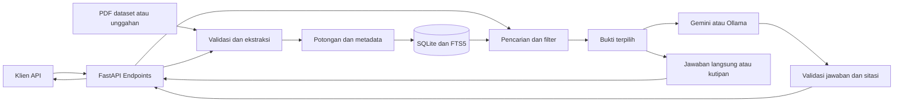

# CampusOrg: Asisten Arsip Notulen Organisasi Berbasis Retrieval-Augmented Generation

**Studi Kasus Soedirman Technophoria 2026**  
**Laporan Kemajuan sampai Pertemuan ke-7 — Kelompok 5**

| Nama anggota | NIM |
| --- | --- |
| Timotius Willy Narendra | H1D025052 |
| Adridinan Najmi Faza | H1D025059 |
| Fardizza Finda Rahman | H1D025067 |
| Kautsar Rifqi Aditya | H1D025084 |
| Haiban Nur Irvanof | H1D025085 |

**Periode verifikasi:** sampai 19 Oktober 2026.  
**Repositori:** [kaxurix/org-rag-llm](https://github.com/kaxurix/org-rag-llm).

Laporan ini mencatat perkembangan prototipe sampai pertemuan ke-7. Hasil pengujian yang sudah tersedia disajikan sebagai hasil awal, sedangkan kesimpulan dibatasi pada fungsi dan skenario yang telah diperiksa. Evaluasi kualitas jawaban secara menyeluruh serta penerapan pada pengguna organisasi masih menjadi pekerjaan lanjutan.

**Susunan laporan:** [1. Pendahuluan](#1-pendahuluan), [2. Related Work](#2-related-work), [3. Metode Penelitian](#3-metode-penelitian), [4. Hasil dan Diskusi](#4-hasil-dan-diskusi), [5. Kesimpulan](#5-kesimpulan), dan [6. Daftar Pustaka](#6-daftar-pustaka).

## 1. Pendahuluan

### 1.1 Latar Belakang

Dalam kegiatan organisasi, informasi yang sudah ditulis belum tentu mudah digunakan kembali. Notulen dapat tersimpan dalam folder yang rapi, tetapi pengurus tetap perlu mengetahui berkas mana yang harus dibuka dan bagian mana yang perlu dibaca. Kajian Nguyen, Connolly, dan Nguyen menempatkan pengelolaan data serta kepercayaan sebagai perhatian dalam pemanfaatan model bahasa untuk manajemen pengetahuan. Cerchione, Liccardo, dan Passaro juga membahas perubahan cara pengetahuan dibentuk dan digunakan ketika AI generatif masuk ke proses organisasi. Sementara itu, penelitian Leoni dkk. memperlihatkan bahwa penerapan AI dalam manajemen pengetahuan dipengaruhi faktor organisasi dan proses pengambilan keputusan, bukan sekadar tersedianya perangkat lunak. [1](https://doi.org/10.12720/jait.16.4.594-612), [2](https://doi.org/10.1016/j.jik.2025.100866), [3](https://doi.org/10.1108/JKM-03-2024-0262)

Pada kepanitiaan mahasiswa, kebutuhan tersebut muncul dalam pertanyaan sederhana, seperti siapa penanggung jawab pembicara atau bagaimana perkembangan sponsor terakhir. Jawabannya bisa tersebar di beberapa rapat dan berubah seiring jalannya persiapan kegiatan. Kajian Karakurt dan Akbulut tentang RAG untuk pengetahuan organisasi menunjukkan pentingnya menghubungkan pengembangan teknis dengan kebutuhan alur kerja. Korzynski dkk. juga menempatkan AI generatif sebagai konteks baru untuk meninjau pekerjaan administratif dan manajerial, meskipun artikel tersebut bersifat konseptual. Temuan dan gagasan itu menjadi alasan untuk menguji kebutuhan serupa pada arsip kepanitiaan, tanpa menganggap bahwa manfaat pada organisasi lain otomatis berlaku pada organisasi mahasiswa. [4](https://doi.org/10.3390/app16010368), [5](https://doi.org/10.1108/CEMJ-02-2023-0091)

Salah satu pendekatan yang sesuai untuk menghubungkan pertanyaan pengguna dengan arsip internal adalah *Retrieval-Augmented Generation* (RAG). Sistem mencari sumber terlebih dahulu, kemudian menggunakan sumber tersebut sebagai konteks model bahasa. Klesel dan Wittmann membahas RAG dalam kaitannya dengan kebutuhan informasi organisasi. Survei Zhao dkk. serta Wu dkk. memperluas pembahasan ke komponen retrieval, penyusunan konteks, dan generasi pada berbagai tugas. Literatur tersebut memberi dasar bagi pengembangan asisten yang menggunakan dokumen milik organisasi sebagai rujukan jawaban. [6](https://doi.org/10.1007/s12599-025-00945-3), [7](https://doi.org/10.1007/s41019-025-00335-5), [8](https://doi.org/10.1007/s10462-026-11605-7)

Kualitas RAG tidak hanya bergantung pada model yang dipilih. Cara dokumen dipotong, metadata yang disimpan, dan bukti yang dimasukkan ke konteks juga menentukan informasi yang tersedia bagi model. Brown, Roman, dan Devereux memetakan teknik, metrik, dan tantangan RAG dalam kajian sistematis. James, Trovati, dan Bolton membahas pengolahan data, metadata, serta strategi retrieval dalam pembentukan aset pengetahuan. Pada arsip notulen, pertimbangan tersebut diterjemahkan menjadi kebutuhan untuk mempertahankan nomor halaman, divisi, dan tanggal rapat pada setiap potongan teks. [9](https://doi.org/10.3390/bdcc9120320), [10](https://doi.org/10.3390/app15116247)

Kesesuaian dengan domain juga perlu diperhatikan. Siriwardhana dkk. menunjukkan pentingnya adaptasi domain dalam pengembangan model RAG, sedangkan Li dkk. meninjau penerapan RAG pada aplikasi pendidikan. Keduanya memberi alasan untuk menguji sistem pada data yang benar-benar digunakan, tetapi tidak menyediakan bukti langsung tentang notulen S-TECH. Karena itu, proyek ini menggunakan pertanyaan, istilah divisi, dan urutan rapat dari korpus sendiri untuk memeriksa perilaku pencarian. Pendekatan adaptasi melalui pelatihan dalam penelitian Siriwardhana dkk. tidak diterapkan dalam prototipe ini. [11](https://doi.org/10.1162/tacl_a_00530), [12](https://doi.org/10.1016/j.caeai.2025.100417)

Di sisi lain, kemampuan model menyusun kalimat yang lancar tetap disertai risiko informasi yang tidak sesuai sumber. Ji dkk. membahas masalah halusinasi dalam generasi bahasa, Huang dkk. meninjau penyebab serta cara mendeteksinya pada LLM, dan Lin dkk. membahas halusinasi bersama persoalan bias dalam pengembangan model yang dapat dipercaya. Ketiga kajian tersebut memperkuat kebutuhan untuk membatasi jawaban pada bukti dan menyediakan jalan bagi pengguna untuk memeriksanya kembali. [13](https://doi.org/10.1145/3571730), [14](https://doi.org/10.1145/3703155), [15](https://doi.org/10.1007/s10462-024-10896-y)

Ketidakpastian model juga tidak selalu tampak dari gaya jawabannya. Shorinwa dkk. meninjau cara mengukur ketidakpastian LLM, sementara Zhao dkk. membahas tantangan menjelaskan perilaku dan keterbatasan model. Pada proyek ini, perhatian tersebut diwujudkan dalam langkah yang lebih terbatas: sistem memberi tahu pengguna ketika bukti tidak ditemukan, model gagal, atau jawaban yang tampil hanya berupa kutipan. Penyediaan kutipan membantu keterlacakan, tetapi belum menjelaskan keseluruhan mekanisme internal model dan belum menjadi penerapan metode kuantifikasi ketidakpastian dari literatur. [16](https://doi.org/10.1145/3744238), [17](https://doi.org/10.1145/3639372)

Penilaian keberhasilan perlu membedakan kemampuan perangkat lunak dan mutu jawaban. Chang dkk. menunjukkan bahwa evaluasi LLM mencakup pertanyaan tentang apa yang diuji, pada konteks apa, dan dengan cara apa. Untuk CampusOrg, pemisahan ini berarti kelulusan tes API, keberhasilan pencarian bukti, dan ketepatan rangkuman tidak boleh digabung menjadi satu klaim akurasi. Model yang berhasil merespons belum tentu menggunakan semua bukti penting yang tersedia. [18](https://doi.org/10.1145/3641289)

Rancangan awal proyek sempat mempertimbangkan graf pengetahuan. Pan dkk. memetakan hubungan LLM dengan *knowledge graph*, termasuk penggunaan graf untuk memperkaya model maupun penggunaan model untuk membangun graf. Namun, alur aktif CampusOrg saat ini belum membentuk entitas dan relasi pengetahuan. Penyimpanan relasi dokumen dengan potongan teks pada database tidak dengan sendirinya menjadi GraphRAG. Oleh sebab itu, laporan pertemuan ke-7 ini menggunakan istilah RAG sesuai implementasi yang tersedia, sedangkan pengembangan berbasis graf ditempatkan sebagai kemungkinan lanjutan. [19](https://doi.org/10.1109/TKDE.2024.3352100)

Berangkat dari kebutuhan tersebut, CampusOrg dikembangkan sebagai prototipe pencarian dan tanya jawab PDF notulen S-TECH 2026. Fokus sampai pertemuan ke-7 adalah memastikan dokumen dapat diolah, bukti dapat ditelusuri hingga halaman sumber, dan aplikasi tetap memberikan informasi ketika generasi AI tidak berjalan. Kajian Knollmeyer dkk. mengenai evaluasi RAG menekankan pemisahan relevansi konteks, kesetiaan jawaban terhadap sumber, ketepatan, dan kualitas sitasi. Pemisahan itulah yang digunakan untuk membatasi pembahasan hasil awal dan menentukan pekerjaan evaluasi berikutnya. [20](https://doi.org/10.1007/s42979-026-05134-x)

### 1.2 Rumusan Masalah

1. Bagaimana mengolah PDF notulen menjadi arsip yang dapat dicari berdasarkan topik, divisi, dan rapat?
2. Bagaimana menyajikan jawaban yang memiliki rujukan sampai halaman sumber dan tetap memperhatikan perubahan informasi antarrapat?
3. Bagaimana mempertahankan fungsi penelusuran ketika bukti belum ditemukan atau layanan model bahasa tidak dapat digunakan?

### 1.3 Tujuan dan Manfaat yang Diharapkan

Tujuan tahap ini adalah membangun dan memeriksa prototipe yang dapat mengimpor PDF, mencari bukti, serta menampilkan jawaban bersama sumbernya. Sistem juga diharapkan dapat membedakan rapat tertentu dari informasi terbaru dalam arsip dan menyediakan kutipan ketika model tidak tersedia.

Bagi pengurus organisasi, manfaat yang dituju adalah lebih mudahnya menemukan kembali informasi dan memeriksa asal jawaban. Namun, penghematan waktu kerja, peningkatan kualitas keputusan, dan kepuasan pengguna belum diukur. Manfaat tersebut masih perlu diuji melalui penggunaan nyata, bukan disimpulkan hanya dari keberhasilan prototipe.

### 1.4 Ruang Lingkup dan Status Proyek

Korpus evaluasi berisi empat PDF notulen S-TECH 2026 yang memiliki teks yang dapat diekstraksi. Pencarian utama menggunakan BM25 pada SQLite FTS5. Gemini `gemini-3.5-flash-lite` digunakan untuk generasi online, sementara Ollama tersedia sebagai alternatif lokal. Tidak dilakukan pelatihan ulang atau *fine-tuning* model.

Sampai pertemuan ke-7, layanan API dan pengujian fungsi dasar sudah tersedia. Pencarian vektor masih berupa opsi yang belum menjadi konfigurasi evaluasi utama. Antarmuka pengguna grafis, OCR, graf pengetahuan, evaluasi RAGAS, pengujian banyak pengguna, dan penilaian kualitas jawaban oleh pengguna belum dilaksanakan. Hasil yang disajikan pada laporan ini karena itu diperlakukan sebagai hasil awal pengembangan.

## 2. Related Work

### 2.1 AI Generatif untuk Manajemen Pengetahuan

Nguyen dkk. [1] membahas penerapan AI generatif dalam pengelolaan dan pertukaran pengetahuan, sedangkan Cerchione dkk. [2] meninjau perubahan pembentukan pengetahuan dari perspektif manajemen. Leoni dkk. [3] melengkapi kajian tersebut dengan penelitian empiris mengenai adopsi AI dalam proses manajemen pengetahuan organisasi. Ketiganya menunjukkan bahwa manfaat teknis perlu dibaca bersama kesiapan data dan proses kerja.

Karakurt dan Akbulut [4] secara lebih khusus meninjau RAG untuk pengetahuan organisasi dan otomasi dokumen. Kajian tersebut relevan untuk membedakan prototipe laboratorium dari sistem yang terhubung ke pekerjaan sehari-hari. Sementara itu, Korzynski dkk. [5] menyediakan kerangka konseptual tentang perubahan konteks manajemen akibat AI generatif. CampusOrg mengambil ruang lingkup yang lebih sempit, yaitu penelusuran notulen satu kegiatan. Proyek ini belum menguji perubahan proses kerja organisasi setelah aplikasi digunakan.

### 2.2 RAG dan Pemilihan Konteks

Klesel dan Wittmann [6] menjelaskan arsitektur RAG dan kaitannya dengan akses informasi organisasi. Zhao dkk. [7] serta Wu dkk. [8] memetakan teknik RAG pada berbagai bentuk generasi dan tugas bahasa. Ketiga rujukan ini digunakan untuk menempatkan retrieval, penyusunan konteks, dan generasi sebagai tahap yang perlu diperiksa secara terpisah.

Brown dkk. [9] membahas hasil penelitian RAG yang tersebar pada berbagai tugas dan metrik. James dkk. [10] menyoroti penyiapan data, metadata, dan strategi pengambilan informasi. Pada CampusOrg, gagasan tersebut diterapkan melalui potongan teks yang menyimpan lokasi halaman serta metadata rapat. Implementasi yang diuji tetap menggunakan pembagian berbatas karakter dan BM25; belum ada eksperimen yang membuktikan bahwa konfigurasi ini lebih baik daripada alternatif semantik.

### 2.3 Penyesuaian terhadap Domain

Siriwardhana dkk. [11] meneliti adaptasi domain melalui pelatihan komponen RAG, sementara Li dkk. [12] menyusun tinjauan aplikasi RAG pada pendidikan. Ruang lingkup dan cara pengujiannya berbeda dari arsip kepanitiaan. Relevansinya bagi proyek ini terletak pada perlunya menggunakan korpus dan pertanyaan yang sesuai kebutuhan sasaran.

Penyesuaian CampusOrg dilakukan melalui metadata rapat, normalisasi istilah, perluasan sinonim, dan aturan pemeringkatan. Cara ini lebih terbatas daripada adaptasi model melalui pelatihan. Karena itu, hasil dari penelitian lain tidak dipindahkan menjadi klaim peningkatan kinerja aplikasi ini.

### 2.4 Halusinasi, Ketidakpastian, dan Keterlacakan

Ji dkk. [13], Huang dkk. [14], dan Lin dkk. [15] menjelaskan risiko keluaran yang tidak sesuai fakta atau konteks serta berbagai upaya penanganannya. Shorinwa dkk. [16] berfokus pada kuantifikasi ketidakpastian, sedangkan Zhao dkk. [17] membahas penjelasan perilaku model. Literatur ini mendasari kehati-hatian dalam menyajikan jawaban, tetapi prototipe belum menerapkan seluruh metode yang mereka tinjau.

Langkah yang sudah tersedia adalah meminta rujukan per paragraf, memvalidasi ID sumber, dan menampilkan kutipan yang dapat dibuka kembali. Batasnya masih jelas: validator belum memeriksa apakah makna setiap klaim sepenuhnya didukung teks. Sistem juga belum menghasilkan skor ketidakpastian yang dikalibrasi.

### 2.5 Evaluasi dan Kemungkinan Pengembangan Graf

Chang dkk. [18] dan Knollmeyer dkk. [20] menekankan perlunya dimensi evaluasi yang jelas. Pada tahap ini, CampusOrg baru memeriksa perilaku kode pada tingkat endpoint API, hasil retrieval berdasarkan kasus, dan satu respons model langsung. Penilaian atas kelengkapan serta ketepatan setiap klaim masih menjadi pekerjaan berikutnya.

Pan dkk. [19] memberi dasar untuk mempertimbangkan integrasi graf apabila kemudian ditemukan pertanyaan relasional yang tidak tertangani. Namun, penambahan graf perlu disertai kebutuhan dan ukuran keberhasilan yang nyata. Membandingkan prototipe sekarang dengan pendekatan graf belum dapat dilakukan karena komponen graf belum tersedia.

### 2.6 Posisi Proyek terhadap Literatur

**Tabel 1. Hubungan penelitian terkait dengan lingkup CampusOrg.**

| Tema | Rujukan | Relevansi untuk proyek | Batas penerapan sampai pertemuan ke-7 |
| --- | --- | --- | --- |
| Pengetahuan organisasi | [1]–[5] | Kebutuhan akses informasi dan kesiapan proses kerja. | Belum ada studi perubahan proses atau manfaat organisasi. |
| Arsitektur dan konteks RAG | [6]–[10] | Pemisahan retrieval, konteks, dan generasi. | Konfigurasi utama masih BM25 dan aturan metadata. |
| Domain dan aplikasi | [11], [12] | Korpus serta pertanyaan perlu sesuai sasaran. | Belum ada pelatihan domain atau korpus lintas kegiatan. |
| Keandalan model | [13]–[17] | Pemeriksaan sumber, ketidakpastian, dan keterbatasan keluaran. | Baru validasi struktur/sitasi dan jalur fallback. |
| Evaluasi | [18], [20] | Memisahkan hasil fungsi, retrieval, dan kualitas jawaban. | Belum ada penilaian generatif menyeluruh. |
| Pengetahuan berbasis graf | [19] | Dasar pertimbangan pengembangan relasional. | Graf belum dibangun dan belum diuji. |

Proyek ini diposisikan sebagai penerapan dan pengujian awal RAG pada notulen organisasi berbahasa Indonesia. Kontribusi yang dapat ditunjukkan saat ini adalah prototipe, pengolahan metadata rapat, penelusuran sumber, dan bukti pengujian yang dapat diulang. Belum ada dasar untuk mengklaim algoritma baru atau keunggulan terhadap seluruh metode yang dibahas dalam literatur.

## 3. Metode Penelitian

### 3.1 Pendekatan dan Tahap Pengembangan

Metode yang digunakan adalah pengembangan prototipe perangkat lunak dengan studi kasus arsip S-TECH 2026. Pekerjaan mencakup pemeriksaan kebutuhan, persiapan dataset, perancangan penyimpanan, implementasi pencarian, integrasi model, dan pengujian fungsi. Uraian ini mencatat komponen yang sudah tersedia sampai pertemuan ke-7, tanpa menetapkan pembagian aktivitas per pertemuan yang belum didokumentasikan.

**Tabel 2. Status pekerjaan pada saat laporan disusun.**

| Pekerjaan | Status |
| --- | --- |
| Penetapan studi kasus dan korpus awal | Sudah tersedia. |
| Pemeriksaan dan perbaikan PDF dataset | Sudah dilakukan. |
| Impor PDF, SQLite, dan indeks teks | Sudah diimplementasikan. |
| Retrieval, filter, dan referensi halaman | Sudah diimplementasikan dan diuji pada kasus yang ditetapkan. |
| Integrasi Gemini dan alternatif Ollama | Sudah tersedia; Gemini telah diuji langsung. |
| Evaluasi kualitas jawaban oleh penilai | Belum dilakukan secara menyeluruh. |
| Perbandingan metode dan uji pengguna | Belum dilakukan. |

Kajian pustaka disusun secara terarah dari artikel jurnal dalam rentang lima tahun terakhir. Untuk tanggal laporan tahun 2026, rentang acuan dibatasi pada 2022–2026; dua puluh artikel yang dipilih terbit pada 2023–2026. Identitas artikel diperiksa melalui DOI, metadata Crossref, serta halaman penerbit atau abstrak yang tersedia. Kajian ini bukan *systematic literature review* dengan penelusuran lengkap dan penilaian risiko bias tersendiri.

### 3.2 Dataset dan Persiapannya

Korpus evaluasi terdiri atas empat PDF berikut.

**Tabel 3. Dataset evaluasi setelah perbaikan.**

| Dokumen | Tanggal rapat | Halaman | Potongan teks |
| --- | --- | ---: | ---: |
| NOTULA RABES STECH 2026 1.pdf | 20 Mei 2026 | 16 | 42 |
| NOTULA RABES STECH 2026 2.pdf | 4 Juli 2026 | 12 | 28 |
| NOTULA RABES STECH 2026 3.pdf | 26 Agustus 2026 | 10 | 25 |
| NOTULA RABES STECH 2026 4.pdf | 7 Oktober 2026 | 19 | 36 |
| **Total** | **Empat rapat** | **57** | **131** |

PDF pertama dan kedua semula memuat rapat tambahan sehingga berjumlah 37 dan 22 halaman. Perbaikan mempertahankan rapat yang sesuai dan menghapus bagian rapat berikutnya melalui redaksi PDF. Penutup rapat pada halaman batas tetap dipertahankan. Rincian pemeriksaan, backup, dan checksum tersedia pada [catatan perbaikan dataset](../PDF_REPAIR_REPORT.md).

Divisi yang dikenali adalah Acara, ATP, Humas, Keamanan, Konsumsi, PDD, Sekbend, dan Usdan. Bagian yang heading-nya belum dikenali menggunakan kategori awal, biasanya Umum. Tidak ada proses anonimisasi otomatis sehingga penggunaan nama dan isi notulen tetap memerlukan perhatian terhadap izin pemilik dokumen.

Evaluasi pencarian memakai database sementara berisi empat PDF tersebut. Database aktif saat pengambilan tampilan berisi enam dokumen, 116 halaman, dan 282 potongan karena juga menyimpan versi PDF gabungan. Statistik database aktif tidak digabung ke perhitungan evaluasi korpus empat PDF.

### 3.3 Arsitektur dan Penyimpanan

Backend menggunakan Python, FastAPI, dan Uvicorn. PyMuPDF digunakan untuk membaca PDF, SQLite FTS5 untuk pengindeksan teks, Pydantic untuk validasi skema request/response, dan HTTPX untuk komunikasi dengan model bahasa. Akses sistem dilakukan melalui endpoint REST API.



**Gambar 1. Arsitektur prototipe backend CampusOrg.**

Tabel `documents` menyimpan PDF, checksum, dan metadata dokumen. Tabel `chunks` menyimpan potongan teks, halaman, divisi, nomor rapat, serta tanggal rapat. Satu dokumen memiliki banyak potongan, sedangkan tabel virtual `chunks_fts` menjadi indeks pencarian. Embedding opsional disimpan pada potongan bersama nama model pembentuknya.

Penyimpanan memakai transaksi, foreign key, dan *write-ahead logging*. Trigger menjaga indeks teks mengikuti perubahan potongan. Profil PostgreSQL/pgvector masih tersedia dari prototipe lama, tetapi aplikasi aktif membaca SQLite. Tidak ada pembentukan graf pengetahuan dalam arsitektur ini.

### 3.4 Pengolahan Dokumen

PDF diperiksa berdasarkan ukuran, format, status enkripsi, jumlah halaman, dan keberadaan teks. Batas bawaan adalah 25 MB dan 300 halaman per berkas. PDF rusak, terkunci, atau tanpa teks yang dapat diindeks ditolak. Halaman dengan hasil teks sangat sedikit dicatat sebagai halaman kosong dan dilewati.

Teks diekstraksi per halaman, dinormalisasi menggunakan Unicode NFKC, dan dirapikan. Nomor rapat, tanggal, serta judul divisi dikenali melalui pola teks. Metadata diteruskan sampai penanda bagian atau rapat berikutnya ditemukan.

Pembagian teks menggunakan batas 1.200 karakter dengan overlap 180 karakter. Pemotongan diupayakan pada spasi atau baris baru dan tidak menggabungkan isi lintas halaman. Metode ini berbasis karakter, belum berupa *semantic chunking* yang menentukan batas melalui model makna. SHA-256 seluruh PDF digunakan untuk menolak impor ulang berkas yang identik, kemudian PDF, metadata, dan potongan disimpan dalam satu transaksi.

### 3.5 Retrieval dan Pengaturan Lingkup Waktu

Pertanyaan ditokenisasi dan dibersihkan dari kata umum. Sinonim manual menghubungkan istilah seperti sponsor/sponsorship, progres/progress, serta PJ/PIC/penanggung jawab. Filter dapat membatasi divisi, tahun, dokumen, dan rapat. Nomor rapat juga dikenali dari teks pertanyaan.

FTS5 mengambil maksimal 120 kandidat BM25. Kandidat diperiksa berdasarkan ketercakupan konsep dan diberi bobot aturan sesuai ciri notulen. Misalnya, bagian kemajuan sponsor diutamakan untuk pertanyaan perkembangan sponsor, sedangkan kalimat keputusan peran dibedakan dari daftar pembagian tugas. Pengurangan duplikasi membatasi kemunculan teks yang sangat mirip dan maksimal dua hasil dari satu halaman.

Jumlah hasil mengikuti `top_k`, dengan bawaan delapan dan rentang satu sampai dua belas. Pada pertanyaan perbandingan, sumber dari rapat berbeda diupayakan hadir jika kandidat relevan tersedia. Penggabungan peringkat juga disediakan untuk jalur vektor opsional, tetapi evaluasi utama tidak mengaktifkan encoder.

Permintaan “terbaru” mengacu pada tanggal rapat terakhir dalam filter aktif. Pertanyaan “siapa” tanpa penanda historis, nomor rapat, atau perbandingan juga menggunakan rapat terbaru secara implisit. Bila bukti tidak ada pada lingkup tersebut, sistem tidak beralih diam-diam ke rapat lama. Aturan ini tetap perlu diuji pada variasi penulisan pertanyaan yang lebih luas.

### 3.6 Pembentukan Jawaban dan Penanganan Gangguan

Gemini `gemini-3.5-flash-lite` menerima pertanyaan, riwayat singkat, dan sumber yang dipilih. Konteks memuat maksimal empat sumber untuk pertanyaan terfokus atau delapan untuk perbandingan, dengan batas sampai 1.600 karakter per sumber. Prompt meminta bahasa Indonesia, jawaban ringkas, pelestarian ketidakpastian, dan rujukan pada tiap paragraf.

Model mengembalikan JSON yang memuat teks serta ID sumber. Pydantic memvalidasi bentuknya, kemudian server memeriksa bahwa ID tersebut termasuk konteks. Validasi belum memeriksa dukungan makna setiap klaim. Karena itu, pengguna tetap diberikan kutipan dan tautan PDF.

**Tabel 4. Mode jawaban prototipe.**

| Mode | Perilaku |
| --- | --- |
| `auto` | Jawaban peran langsung jika sesuai; jika perlu memakai model terpilih; kegagalan ditangani dengan kutipan. |
| `extractive` | Menampilkan kutipan tanpa generasi. |
| `gemini` | Mewajibkan Gemini; kegagalan generasi menghasilkan HTTP 503. |
| `ollama` | Mewajibkan Ollama; kegagalan generasi menghasilkan HTTP 503. |

Tanpa bukti, sistem dapat mengembalikan `no_evidence` tanpa memanggil model. Pernyataan peran yang eksplisit dapat dirender sebagai `source_match`. Label mode aktual ditampilkan agar pengguna mengetahui asal respons.

Batas waktu Gemini secara bawaan adalah 40 detik. Ketika kuota habis, model terlambat, atau sitasi tidak sah, mode `auto` menampilkan kutipan dengan alasan seperti `rate_limited`, `llm_timeout`, atau `invalid_citations`. Generasi dibatasi satu slot per proses agar permintaan tidak menumpuk. Belum tersedia pengelolaan antrean global lintas beberapa server.

### 3.7 Rancangan Pengujian

Pengujian dipisahkan menjadi tes perangkat lunak, evaluasi retrieval, dan uji generasi langsung. Pemisahan ini mengikuti kebutuhan untuk menjelaskan apa yang sebenarnya diukur pada tiap hasil, sebagaimana dibahas dalam literatur evaluasi [18], [20].

Tes otomatis memakai database sementara dan respons HTTP simulasi untuk gangguan model. Evaluator retrieval mengimpor empat PDF, kemudian menjalankan 20 kasus BM25 dengan `top_k=8`. Lima belas kasus mengharapkan bukti tertentu, sedangkan lima kasus mengharapkan hasil kosong. Syarat dapat mencakup kemunculan teks bukti, keterwakilan rapat, atau batas divisi/rapat. Daftar kasus tersimpan pada [eval_cases.json](../eval_cases.json).

Uji generasi langsung dilakukan melalui pemanggilan endpoint API `/api/ask` dengan model Gemini nyata.

Perintah berikut dapat digunakan untuk mengulang pemeriksaan dasar dari root proyek:

```powershell
.\venv\Scripts\python.exe -m unittest discover -s tests -v
.\venv\Scripts\python.exe evaluate.py
```

Evaluasi jawaban generatif oleh penilai, perbandingan metode, pengujian beban, dan pengukuran latensi berulang belum dilakukan.

### 3.8 Pengelolaan Data dan Privasi

Key penyedia AI berada pada konfigurasi server dan berbeda dari key pelindung arsip. Endpoint data dapat dilindungi melalui `X-API-Key`, sementara server secara default mendengarkan localhost. PDF dan database tersimpan lokal, tetapi pertanyaan serta potongan konteks dikirim ke penyedia ketika memakai Gemini.

Dengan demikian, pemakaian Gemini perlu mempertimbangkan izin penggunaan notulen dan ketentuan layanan. Prototipe belum menyediakan anonimisasi otomatis, akun individual, hak akses per divisi, maupun audit pengguna. Untuk konteks yang mewajibkan pemrosesan lokal, tersedia mode kutipan dan alternatif Ollama. Rincian konfigurasi teknis dicantumkan pada [README proyek](../README.md).

## 4. Hasil dan Diskusi

### 4.1 Capaian Awal sampai Pertemuan ke-7

Sampai tahap ini, impor PDF, penyimpanan, pencarian, dan penyajian sumber telah tersambung dalam layanan backend. Gemini dapat dipanggil melalui API untuk membentuk jawaban, sementara kutipan tetap tersedia ketika generasi tidak digunakan atau gagal.

**Tabel 5. Ringkasan verifikasi awal pada 19 Oktober 2026.**

| Pemeriksaan | Hasil | Arti hasil |
| --- | --- | --- |
| Tes otomatis | 72 tes lulus. | Perilaku yang diperiksa sesuai harapan tes. |
| Evaluasi retrieval | 20 dari 20 kasus lulus. | Bukti dan filter memenuhi syarat kasus yang ditetapkan. |
| Satu uji Gemini langsung | Berhasil tanpa fallback. | Jalur generasi online dapat dipanggil dan mengembalikan respons valid. |

Tabel ini belum menunjukkan keberhasilan penggunaan di organisasi sehari-hari. Pengurus belum dilibatkan dalam penilaian manfaat dan kepuasan, sementara variasi dokumen maupun pertanyaan masih terbatas.

### 4.2 Pengujian Otomatis dan Retrieval

Rangkaian otomatis terdiri dari 13 tes penyimpanan, 5 tes pembagian teks, 12 tes API, 14 tes jawaban, 13 tes dataset nyata, 3 tes semantik, 3 tes perbaikan PDF, dan 9 tes Gemini. Seluruhnya lulus. Tes semantik memakai encoder simulasi dan tes Gemini otomatis memakai respons HTTP simulasi, sehingga tidak mewakili pengukuran mutu kedua model secara langsung.

Pada evaluasi retrieval, 15 kasus positif mengembalikan bukti yang diharapkan dan 5 kasus negatif tidak menghasilkan potongan relevan menurut evaluator. Kasus mencakup penanggung jawab, vendor, kendala divisi, tanggal rapat, sponsor terbaru, perbandingan, dan pertanyaan di luar arsip. Rincian tersedia pada [hasil evaluasi](../EVALUATION.md).

Angka 20/20 menyatakan kelulusan kasus, bukan akurasi AI 100%. Evaluator memeriksa bukti serta filter, tidak menilai seluruh kalimat jawaban. Pertanyaan juga disusun dari korpus yang dikenal pengembang, sehingga belum menjadi himpunan uji independen. Keterbatasan tersebut sejalan dengan perlunya dimensi evaluasi yang terpisah dalam [18] dan [20].

### 4.3 Pengamatan Generasi Gemini

Satu permintaan “Bandingkan perkembangan sponsorship pada semua rapat” berhasil menghasilkan respons dengan `answer_mode=gemini`, model `gemini-3.5-flash-lite`, dan tanpa fallback.

**Tabel 6. Satu pengamatan generasi pada database aktif.**

| Parameter | Hasil yang diamati |
| --- | --- |
| Database | Enam dokumen; terpisah dari korpus evaluasi empat PDF. |
| Durasi retrieval | 0,009 detik. |
| Durasi generasi | 5,253 detik. |
| Durasi server total | 5,262 detik. |
| Sumber konteks | 8. |
| Karakter teks sumber dalam konteks | 7.058. |
| Token input/output yang dilaporkan | 2.467 / 146. |
| Fallback | Tidak ada. |

Jawaban merangkum persiapan sponsor pada Mei, penyebaran proposal pada Juli, serta tindak lanjut pada Oktober dengan rujukan `[S1]`, `[S2]`, dan `[S3]`. Namun, rapat Agustus belum dibahas secara eksplisit, meskipun bukti lintas rapat tersedia. Hal ini memperlihatkan bahwa keberhasilan pengambilan sumber dan validasi sitasi belum menjamin kelengkapan rangkuman.

Durasi sekitar 5,3 detik berasal dari satu pengamatan, bukan rata-rata atau jaminan waktu respons. Belum ada percobaan berulang untuk mengukur variasi jaringan dan model, serta belum ada pembandingan Gemini dan Ollama dengan pertanyaan serta korpus yang sama.

### 4.4 Struktur Respons dan Pemeriksaan Sumber

Layanan backend mengembalikan payload JSON terstruktur yang memuat teks jawaban, kutipan potongan teks, nomor halaman, tanggal rapat, serta tautan berkas sumber. Pada pertanyaan peran yang eksplisit, endpoint mengembalikan label jawaban langsung dari arsip (`source_match`) sehingga respons tersebut dapat dibedakan dari generasi model. Format terstruktur ini memungkinkan klien apa pun di masa depan membedakan klaim ringkasan dari bukti aslinya.

### 4.5 Pembahasan dan Pekerjaan Berikutnya

Hasil awal memperlihatkan bahwa pemisahan retrieval dari generasi memberi manfaat operasional pada prototipe. Bukti tetap tersedia ketika model tidak dapat dipakai, dan pernyataan peran tertentu dapat disajikan langsung tanpa panggilan model. Namun, manfaat bagi waktu kerja pengguna belum diukur.

BM25 dan metadata menyediakan dasar yang mudah diperiksa pada korpus kecil. Kekeliruan hasil dapat ditelusuri ke ekstraksi, istilah, filter, atau peringkat. Pilihan ini belum membuktikan keunggulan terhadap pencarian semantik. Sebelum menambah metode, perlu disusun pembanding yang menggunakan korpus dan pertanyaan yang sama agar perubahan hasil dapat dinilai dengan jelas [9], [11].

Contoh rangkuman yang melewatkan Agustus menjadi perhatian untuk tahap berikutnya. Struktur jawaban per rapat atau ruang jawaban yang lebih panjang dapat diuji, tetapi perbaikannya harus dinilai berdasarkan kelengkapan dan dukungan bukti. Menambah sitasi saja belum menjawab masalah tersebut [14], [20].

Prioritas setelah pertemuan ke-7 adalah memperluas pertanyaan uji, melibatkan penilai di luar pengembang, dan menilai ketepatan fakta, kelengkapan, serta lingkup waktu. Setelah dasar evaluasi tersedia, eksperimen hybrid retrieval, perubahan ukuran potongan, dan pengulangan pengukuran latensi dapat dilakukan. GraphRAG tetap menjadi kemungkinan lanjutan apabila kebutuhan relasi antardokumen telah ditemukan, bukan capaian yang sudah diklaim pada tahap ini.

## 5. Kesimpulan

### Kesimpulan Sementara

Sampai pertemuan ke-7, CampusOrg telah memiliki prototipe backend yang mengolah PDF notulen, menyimpan metadata rapat, mencari bukti melalui SQLite FTS5/BM25, dan menyajikan jawaban bersama sumber melalui REST API. Gemini digunakan untuk generasi online, sedangkan jawaban langsung serta kutipan menyediakan jalur fallback sesuai kondisi. Implementasi yang tersedia adalah RAG berbasis dokumen dan metadata; graf pengetahuan dan antarmuka visual belum dibangun.

Verifikasi awal menghasilkan 72 tes otomatis lulus dan 20 kasus retrieval memenuhi syarat evaluator. Satu uji Gemini juga menghasilkan jawaban tanpa fallback dalam sekitar 5,3 detik waktu server. Hasil tersebut mendukung kesimpulan bahwa alur fungsional backend prototipe sudah berjalan pada lingkup pengujian saat ini.

Efektivitas pada penggunaan organisasi dan kualitas jawaban secara menyeluruh belum dapat disimpulkan. Rangkuman yang belum mencakup seluruh rapat menunjukkan perlunya evaluasi generatif lebih lanjut. Pekerjaan berikutnya diarahkan pada pertanyaan uji yang lebih beragam, penilaian independen, dan pengukuran yang konsisten sebelum melakukan perbandingan metode, pembangunan antarmuka pengguna, atau penerapan yang lebih luas.

## 6. Daftar Pustaka

Seluruh 20 rujukan bernomor berikut merupakan artikel jurnal terbitan 2023–2026 dan telah digunakan dalam pendahuluan. Rentang tersebut berada dalam batas lima tahun terakhir yang digunakan pada laporan ini, yaitu 2022–2026. Judul, penulis, jenis publikasi, dan DOI diperiksa melalui metadata Crossref serta informasi penerbit. Tahun pada DOI tidak selalu sama dengan tahun penerbitan artikel. Untuk artikel yang sudah memiliki edisi jurnal, tahun edisi digunakan bila diketahui; publikasi daring yang mendahului edisi diberi keterangan seperlunya.

1. Nguyen, L.T.K.; Connolly, J.; Nguyen, H.N. (2025). A Systematic Review of Improving Knowledge Management with Generative AI and Large Language Models. *Journal of Advances in Information Technology*, 16(4), hlm. 594–612. [DOI: 10.12720/jait.16.4.594-612](https://doi.org/10.12720/jait.16.4.594-612).

2. Cerchione, R.; Liccardo, G.; Passaro, R. (2026). Artificial knowledge generation: investigating the revolutionary role of generative AI in knowledge management. *Journal of Innovation & Knowledge*, 11, Artikel 100866. [DOI: 10.1016/j.jik.2025.100866](https://doi.org/10.1016/j.jik.2025.100866).

3. Leoni, L.; Gueli, G.; Ardolino, M.; dkk. (2024). AI-empowered KM processes for decision-making: empirical evidence from worldwide organisations. *Journal of Knowledge Management*, 28(11), hlm. 320–347. [DOI: 10.1108/jkm-03-2024-0262](https://doi.org/10.1108/jkm-03-2024-0262).

4. Karakurt, E.; Akbulut, A. (2026). Retrieval-Augmented Generation (RAG) and Large Language Models (LLMs) for Enterprise Knowledge Management and Document Automation: A Systematic Literature Review. *Applied Sciences*, 16(1), Artikel 368. [DOI: 10.3390/app16010368](https://doi.org/10.3390/app16010368). Terbit daring 29 Desember 2025; edisi jurnal 2026.

5. Korzynski, P.; Mazurek, G.; Altmann, A.; dkk. (2023). Generative artificial intelligence as a new context for management theories: analysis of ChatGPT. *Central European Management Journal*, 31(1), hlm. 3–13. [DOI: 10.1108/cemj-02-2023-0091](https://doi.org/10.1108/cemj-02-2023-0091).

6. Klesel, M.; Wittmann, H.F. (2025). Retrieval-Augmented Generation (RAG). *Business & Information Systems Engineering*, 67(4), hlm. 551–561. [DOI: 10.1007/s12599-025-00945-3](https://doi.org/10.1007/s12599-025-00945-3).

7. Zhao, P.; Zhang, H.; Yu, Q.; dkk. (2026). Retrieval-Augmented Generation for AI-Generated Content: A Survey. *Data Science and Engineering*, 11(1), hlm. 1–29. [DOI: 10.1007/s41019-025-00335-5](https://doi.org/10.1007/s41019-025-00335-5).

8. Wu, S.; Xiong, Y.; Cui, Y.; dkk. (2026). Retrieval-augmented generation for natural language processing: a survey. *Artificial Intelligence Review*, 59(9), Artikel 192. [DOI: 10.1007/s10462-026-11605-7](https://doi.org/10.1007/s10462-026-11605-7).

9. Brown, A.; Roman, M.; Devereux, B. (2025). A Systematic Literature Review of Retrieval-Augmented Generation: Techniques, Metrics, and Challenges. *Big Data and Cognitive Computing*, 9(12), Artikel 320. [DOI: 10.3390/bdcc9120320](https://doi.org/10.3390/bdcc9120320).

10. James, A.; Trovati, M.; Bolton, S. (2025). Retrieval-Augmented Generation to Generate Knowledge Assets and Creation of Action Drivers. *Applied Sciences*, 15(11), Artikel 6247. [DOI: 10.3390/app15116247](https://doi.org/10.3390/app15116247).

11. Siriwardhana, S.; Weerasekera, R.; Wen, E.; dkk. (2023). Improving the Domain Adaptation of Retrieval Augmented Generation (RAG) Models for Open Domain Question Answering. *Transactions of the Association for Computational Linguistics*, 11, hlm. 1–17. [DOI: 10.1162/tacl_a_00530](https://doi.org/10.1162/tacl_a_00530).

12. Li, Z.; Wang, Z.; Wang, W.; dkk. (2025). Retrieval-augmented generation for educational application: A systematic survey. *Computers and Education: Artificial Intelligence*, 8, Artikel 100417. [DOI: 10.1016/j.caeai.2025.100417](https://doi.org/10.1016/j.caeai.2025.100417).

13. Ji, Z.; Lee, N.; Frieske, R.; dkk. (2023). Survey of Hallucination in Natural Language Generation. *ACM Computing Surveys*, 55(12), hlm. 1–38. [DOI: 10.1145/3571730](https://doi.org/10.1145/3571730).

14. Huang, L.; Yu, W.; Ma, W.; dkk. (2025). A Survey on Hallucination in Large Language Models: Principles, Taxonomy, Challenges, and Open Questions. *ACM Transactions on Information Systems*, 43(2), hlm. 1–55. [DOI: 10.1145/3703155](https://doi.org/10.1145/3703155).

15. Lin, Z.; Guan, S.; Zhang, W.; dkk. (2024). Towards trustworthy LLMs: a review on debiasing and dehallucinating in large language models. *Artificial Intelligence Review*, 57(9), Artikel 243. [DOI: 10.1007/s10462-024-10896-y](https://doi.org/10.1007/s10462-024-10896-y).

16. Shorinwa, O.; Mei, Z.; Lidard, J.; dkk. (2026). A Survey on Uncertainty Quantification of Large Language Models: Taxonomy, Open Research Challenges, and Future Directions. *ACM Computing Surveys*, 58(3), hlm. 1–38. [DOI: 10.1145/3744238](https://doi.org/10.1145/3744238). Terbit daring 9 September 2025; edisi 58(3) terbit 2026.

17. Zhao, H.; Chen, H.; Yang, F.; dkk. (2024). Explainability for Large Language Models: A Survey. *ACM Transactions on Intelligent Systems and Technology*, 15(2), hlm. 1–38. [DOI: 10.1145/3639372](https://doi.org/10.1145/3639372).

18. Chang, Y.; Wang, X.; Wang, J.; dkk. (2024). A Survey on Evaluation of Large Language Models. *ACM Transactions on Intelligent Systems and Technology*, 15(3), hlm. 1–45. [DOI: 10.1145/3641289](https://doi.org/10.1145/3641289).

19. Pan, S.; Luo, L.; Wang, Y.; dkk. (2024). Unifying Large Language Models and Knowledge Graphs: A Roadmap. *IEEE Transactions on Knowledge and Data Engineering*, 36(7), hlm. 3580–3599. [DOI: 10.1109/tkde.2024.3352100](https://doi.org/10.1109/tkde.2024.3352100).

20. Knollmeyer, S.; Caymazer, O.; Koval, L.; dkk. (2026). Evaluating Retrieval Augmented Generation: A Comprehensive Review of Evaluation Dimensions, Question Types, and Application. *SN Computer Science*, 7(5), Artikel 576. [DOI: 10.1007/s42979-026-05134-x](https://doi.org/10.1007/s42979-026-05134-x).

Dokumen pendukung implementasi dapat diperiksa melalui [README](../README.md), [kode pengolahan PDF](../ingestion.py), [kode retrieval](../retrieval.py), [kode jawaban](../answering.py), serta [hasil evaluasi pencarian](../EVALUATION.md). Dokumen proyek tersebut digunakan untuk memeriksa uraian implementasi dan hasil, dan tidak dihitung sebagai pengganti 20 artikel jurnal di atas.
